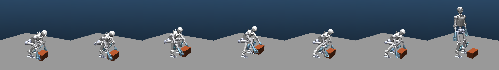

# Phybot C2 双手 microspine 搬砖

任务是双脚留在原地，从地面接近并挂住测试砖块，抬起、侧移、放回地面，
卸载后撤手并站起。使用当前 Phybot C2 资产、双手被动 gimbal 和 21 个关节位置动作。
不包含行走。默认每只手只启用四个角部 microspine 单元，实物也需要匹配这个配置。
标称尺寸、质量和起终点定义在
[`BrickCfg`](../src/scr_phybot_mjab/assets/brick.py)。

环境基于本仓库固定的 mjlab 1.5、MuJoCo 3.10 和 MuJoCo Warp 3.10；
本次验证使用 `env_mjlab15`。保留默认启用的 `PHYBOT_C2_PAD_GIMBAL=1`。

## 任务与训练顺序

| Task ID 后缀 | 初始状态 | 训练范围 |
| --- | --- | --- |
| `-Hold` | 已抬起，双手已挂接 | 保持、侧移到目标上方 |
| `-Engage` | 手位于砖块两侧、未挂接 | 压紧、挂接、抬起并保持 |
| `-Place` | 位于目标上方，双手已挂接 | 放置、卸载、撤手 |
| 无后缀 | 站立、砖块在地面、未挂接 | 完整取放并站起 |
| `-DR` | 完整任务，带随机化 | 质量、摩擦、PD、位姿误差和丢帧适应 |
| `-NoGrip` | 完整任务，关闭挂接 | 检查普通摩擦夹持是否绕过 microspine |

完整前缀均为 `Mjlab-Microspine-Brick-Phybot-C2`。Hold/Place 的已挂接状态仅用于
参考状态初始化，完整任务与 Engage 必须通过真实接触条件建立挂接。阶段时钟不控制开关。

先检查参考和并行环境：

```bash
conda activate env_mjlab15
python scripts/gen_brick_reference.py
python scripts/validate_brick_task.py --stage hold --num-envs 4 --steps 200
CUDA_VISIBLE_DEVICES=0 PHYBOT_BRICK_GPU_TEST=1 python -m pytest -q tests/microspine/test_brick_gpu.py
```

训练 Hold：

```bash
python scripts/train.py Mjlab-Microspine-Brick-Phybot-C2-Hold \
  --gpu-ids '[0]' --env.scene.num-envs 1024 --agent.run-name hold
```

日志默认写入本地 TensorBoard，目录为 `logs/rsl_rl/phybot_c2_microspine_brick`。
后续阶段使用相同网络、动作与观测布局，可从前一阶段的 checkpoint 继续：

```bash
python scripts/train.py Mjlab-Microspine-Brick-Phybot-C2-Engage \
  --gpu-ids '[0]' --env.scene.num-envs 1024 --agent.run-name engage \
  --agent.resume --agent.load-run '<上一阶段运行目录名>' \
  --agent.load-checkpoint model_5000.pt
```

同样切换到 `-Place`、无后缀的完整任务，最后 `-DR`。阶段训练完成后先评估，再决定是否
继续训练或切换；固定迭代数不保证掌握技能。Hold/Place 的成功不能算作完整取放成功。

## 接触模型

砖块是带质量和转动惯量的自由刚体。左、右手分别绑定砖块局部坐标系的两侧有限矩形面。
`MicrospineSurfaceCfg` 指定目标 entity/body/geom、局部面原点、法向、切向和半尺寸。
每个手掌的完整接触 footprint 必须位于相应面内，越过边缘会释放。

普通接触提供预压，满足当前 empirical unit 模型的逐单元门槛后才建立约束：每手 4 个角部
单元，每个单元估计压紧力至少 10 N，法向对齐误差不超过 5°，连续满足 3 个控制步。
估计力由同一时刻的接触力、力矩和接触位置分配得到，不等同于逐单元实测力。

约束连接手掌和砖块，锚点保存在砖块局部坐标系，双方都受到约束反力和力矩。
挂接期间保留锚点，按逐单元载荷极限释放；不自动重置锚点来消除载荷。
挂接后收回接触代理，避免普通接触与约束重复承担同一接触。

手与砖块的普通滑动摩擦系数为 0.2。搬运阶段惩罚持续夹紧、相对滑动、超载和脚部漂移；
预压阶段豁免夹紧惩罚。`-NoGrip` 保留普通接触、移除挂接能力，评估中应与正常任务比较。
这项对照用于发现摩擦夹持的替代解；奖励权重本身不保证消除替代解。

新增移动表面是可选配置，原有固定墙任务继续使用原路径。

## 参考、奖励与成功条件

参考文件为 [`brick_pick_place.npz`](../src/scr_phybot_mjab/assets/motions/brick_pick_place.npz)，
审计结果为同目录下的 [`brick_pick_place.audit.json`](../src/scr_phybot_mjab/assets/motions/brick_pick_place.audit.json)。
生成入口是 [`scripts/gen_brick_reference.py`](../scripts/gen_brick_reference.py)，
IK 与加载逻辑在 [`tasks/brick/reference.py`](../src/scr_phybot_mjab/tasks/brick/reference.py)。
参考包含七阶段的关节、根部、被动 gimbal、手掌和砖块轨迹，每阶段 21 个采样姿态：
`reach → engage → lift → carry → place → release → stand`。
阶段轨迹完成后，需要测量门槛连续满足相应 dwell 才前进；位姿丢帧时冻结时钟。
actor 没有仿真挂接状态，阶段切换也不读取它。

参考生成器检查关节限位、脚部位移、手掌位姿、砖块碰撞、自碰撞、非法触地和静态支撑范围。
失败的生成结果写入 `*.failed.npz` 和对应审计 JSON，保留已有的有效参考文件。
另以每手 40 N 压紧力和重力估计主动手臂的静态力矩需求。
这个力矩检查没有求解全部接触力、gimbal 支撑或动态稳定性，因此仍需动态验证。
`dynamic_preload_validated: false` 明确表示参考文件没有证明真实预压和挂接成功。

12 单元版本要求每手至少 120 N。初始可达姿态的肩关节静态需求约 63 N·m，超过当前
58 N·m 限值；继续约束力矩的求解未同时通过几何审计。因此默认使用四角单元基线，
没有提高电机力矩或降低逐单元 10 N 门槛。保留 `unit_layout="all"` 和生成器
`--unit-layout all` 供进一步研究，但必须提供通过相应审计的参考。



[观看完整参考动画（约 23 秒）](brick_reference.mp4)。视频带阶段名称和参考时间；
使用各阶段的标称时长，不包含运行时测量条件尚未满足时的额外等待。
图片和视频展示运动学姿态，不代表训练后 policy 的动力学效果。

可重新渲染视频或阶段端点；无显示器时可使用 OSMesa：

```bash
MUJOCO_GL=osmesa python scripts/render_brick_reference.py --output docs/brick_reference.mp4
MUJOCO_GL=osmesa python scripts/render_brick_reference.py --output docs/brick_reference_preview.png
```

完整任务的评分使用仿真真值，要求：

- 相对地面初始位置抬升至少 10 cm，速度低于 5 cm/s，持续 1 s。
- 在空中搬到目标附近；默认侧移 15 cm。
- 放置位置误差不超过 3 cm，姿态误差不超过 10°，已解除挂接并稳定至少 1 s。
- 撤手后回到站姿；整个 episode 内脚部最大漂移不超过 3 cm。

跌倒、明显滑脚、搬运中掉落、非手掌部位碰砖或非脚部触地会终止 episode。
每回合最长 30 s，物理步长 2 ms，控制频率 50 Hz。
奖励同时包含动作参考、物体/双手目标、一次性阶段进展、挂接质量、脚漂和失败项。
持续稳定保持可以得到稠密奖励，完整成功单独评分。

更改砖块几何后需要重新生成参考，并同步环境的 `brick` 与 `reference_file` 配置，例如：

```bash
python scripts/gen_brick_reference.py --size .18 .32 .20 --mass 1.0 \
  --start-x .32 --goal-y .15 --output /tmp/custom_brick.npz
```

尺寸、质量、起点、终点或抬升高度与参考不一致时，环境会拒绝加载。
修改参考文件不能直接修改已经注册的任务；自定义环境可调用
`brick_env_cfg(brick=BrickCfg(...))` 并设置 `cfg.commands["brick_task"].reference_file`。

## 观测与实机接口

actor 每帧 117 维，按观测项堆叠 10 帧，共 1170 维。包含 gyro、重力方向、21 个关节位置与
速度、上一步动作，以及 48 维任务命令。默认 critic 为 164 维，另有砖块真值、被动关节、
挂接、载荷、承载裕度、单元强度和质量。actor 不读取接触力、约束或单元强度。

任务命令布局：

| 每帧区间 | 内容 |
| --- | --- |
| `[0:7]` | 砖块相对机器人基座位姿 |
| `[7:14]` | 目标相对基座位姿 |
| `[14:17]` | 由外部位姿差分、过滤得到的砖块线速度，表达在基座坐标系 |
| `[17:19]` | 位姿有效标志、数据年龄（秒） |
| `[19:26]` | 阶段 one-hot |
| `[26:27]` | 当前阶段进度 |
| `[27:48]` | 21 个参考关节位置减去编码器位置 |

仿真中外部跟踪由带误差、延迟和可选丢帧的合成测量代理提供。实机需要砖块与机器人基座
在同一重力对齐世界坐标系中的位姿、已标定的地面和目标位姿。**基座位置不是仅靠 IMU
即可得到的量**；必须来自外部跟踪或已经验证的状态估计器。被动 gimbal 不进入 actor 的
手掌 FK，使用主动前臂的名义安装偏置；不假设腕部六维力传感器。

输出为 21 个参考位置修正量：`q_target = q_reference(phase, progress) + 0.25 * action`，沿用当前机器人 PD
和力矩限值。导出文件内嵌 actor normalization，部署输入应为原始观测。
零动作对应当前阶段的参考姿态，Hold/Place 初始化时也适用；该接口需要动态参考位置，
不能直接套用 walk 任务的固定站姿偏置。

```bash
python scripts/export_policy.py Mjlab-Microspine-Brick-Phybot-C2 \
  --checkpoint-file logs/rsl_rl/phybot_c2_microspine_brick/<run>/model_5000.pt
```

导出包括 `policy.pt`、`policy_meta.json`、`brick_reference.npz` 和 `brick_task_meta.json`。
后者记录命令布局、坐标约定、过滤方式、阶段时钟、所需测量和参考文件哈希。
目前提供的是接口契约与导出，尚未实现硬件相机/动捕接入，也未做实机闭环验证。

## 评估

```bash
python scripts/validate_brick_task.py --policy <exported/policy.pt> \
  --num-envs 32 --episodes 100 --report /tmp/brick_nominal.json
python scripts/validate_brick_task.py --policy <exported/policy.pt> \
  --num-envs 32 --episodes 100 --dr --report /tmp/brick_dr.json
python scripts/validate_brick_task.py --policy <exported/policy.pt> \
  --num-envs 32 --episodes 100 --no-grip --report /tmp/brick_no_grip.json
```

报告记录完整成功、阶段完成、抬升/搬运、失败/超时、终止阶段、峰值载荷、脚漂与释放原因。
`--stage hold/engage/place` 可单独评估阶段。默认使用确定的 seed；更改 `--seed` 运行独立批次。
未传 `--policy` 时仅执行参考关节 PD 回放，报告标记为 `reference_pd_diagnostic`，不能当作
训练后的成功率。稳定性、预压成功率以及 100 回合成功率都需要训练后实际测量。

无 GPU 时，诊断脚本可传 `--device cpu`；并行物理测试支持
`PHYBOT_BRICK_GPU_TEST=1 PHYBOT_BRICK_TEST_DEVICE=cpu python -m pytest -q tests/microspine/test_brick_gpu.py`。

## 本次实现的验证记录

[验证记录](brick_task_validation.json) 包含参考、导出与评估使用的文件哈希。2026-09-17 的
最终检查为 106 项测试通过（含五种配置的 Warp CPU 物理与局部 reset 检查）、两轮 PPO
更新、8 步 TorchScript 与 runner 输出完全一致。默认参考已从头重新生成并通过审计。
残差动作改动前通过过五种配置的 GPU 检查；会话权限切换后 CUDA 不可见，最终复验使用 CPU。

两轮 PPO 的测试 checkpoint 在四个 Hold 回合中没有成功，出现脱钩。该结果验证的是训练、
导出和评估通路；尚无收敛策略，也没有动态预压成功率、完整取放成功率或实机验证结果。
