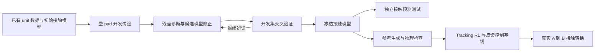

**统一实验方案：Agent 修正 microspine 接触模型，并验证真实技能迁移**

2026-09-09。本文件是整 pad 阶段的历史方案，已被用户最新方向下的[单 unit 模型资产方案](icra_2027_unit_asset_plan_2026-09-09.md)取代。当前 bare minimum 不要求整 pad；RL 用于验证冻结资产的后续复用。下文矩阵与次数不再作为当前执行预算。

本轮完成的是设计与条件矩阵，尚未采集新数据、修改接触内核、调用收费模型、训练 RL 或运行机器人。计划按一个机械臂、一种最终部署的 microspine pad、一块现有粗糙面板展开；使用实际力/力矩、机器人状态和 pad—墙面相对位姿。实物装配、单位数、可传递力矩和当前自动化程度仍以硬件核实为准。

**论文只围绕一条主线**

现有单 unit 失效数据提供承载先验，但“满足条件便挂接—equality 承载—越界便脱离”的模型未必能预测建立、变形和释放。研究目标是：让 agent 根据真实交互残差，区分参数误差与缺失机制，提出受约束的模型修正；再检验修正后的仿真是否有助于参考生成与真实技能执行。

候选贡献为：（1）接触残差驱动的诊断与模型修正方法；（2）整 pad 在未参与辨识的条件下对建立、承载、位移和释放的预测证据；（3）冻结模型指导的参考与真实接触转换技能。第二、三项是物理证据与系统验证，不自动算成两种新算法。单 unit/整 pad 曲线是研究基础，agent、reference 和 RL 不要求各占一项新颖性。

作者的 [GPT6-real2sim 复盘](https://github.com/lingxiao-guo/GPT6-real2sim/blob/main/real2sim_pipeline.md#4-agentic-physical-parameter-id)展示了 agent 直接试改参数的流程，也明确区分校准尝试、敏感性试验和真正辨识到的物理值。因此本方案允许 agent 直接搜索，优化器作为对照或工具选项；判据落实在独立物理预测上。相关概念也已有 [Agentic Real2Sim](https://arxiv.org/html/2607.19190v3)，本项目需证明具体修正方式的增量。

**E0：先导与接口检查，先完成才能解释后续结果**

建议 8–12 次重新挂接，另加必要的自由空间动作，全部记为开发。先导用于选定可重复的载荷、速度和行程范围，估计噪声、复位时间及数值计算成本；不是最终测试。

- 确认实际 pad 布局和腕部连接，检查工具重力补偿、力/力矩符号与参考点。将 wrench 统一到 pad 中心；动态段考虑工具惯性。自由球铰下不强行独立施加任意力矩，首版不声称完整六维承载边界。
- 对齐指令、实际力/力矩、关节/TCP、pad 相对墙面位姿及视频的时钟。柔顺腕部下仅 TCP 位移不能分离 pad 滑移与安装件变形；无法分离时报告综合有效响应。
- 首先检查真实与仿真的执行接口及自由空间响应。区分执行器延迟、测量滤波与接触过程。
- 定义建立成功、规定载荷保持、首次可见滑移、最终脱离、释放完成、实验行程上限和中止规则。没有逐 unit 观测时只标 pad 级事件。
- 保存指令与实测量。现有 unit 表主要使用指令失效力，应从详细日志重提失效前稳定段；新旧模型使用一致观测定义，不能把失效后已跌落的力值当成承载能力。旧 unit 数据不重采、原始文件不覆盖。
- 同时跑通一条本地反馈程序的“建立—加载—卸载—退出”和最小仿真动作接口。仓库当前 [Rizon4 配置](../src/scr_phybot_mjab/tasks/microspine_rizon4/config/rizon4/env_cfgs.py)仍有 `rewards={}`，不能据现有人形训练经验假定机械臂 RL 已实现。

先导后冻结物理量配置文件：预压档位、拖动距离、加载速率、卸载程度、力级步长、各阶段时限和阈值。本文及 CSV 中的 `low/mid/high` 均是待填的实验水平，不是可下发机器人命令。

**E1：统一采集 128 条整 pad 接触试验，四类各 32 条**

目的同时包括参数辨识、模型结构判断与独立预测验证。将原先偏重失效曲线的预算重新分配给四个过程。

| 类别 | 开发条件 | 每次过程与主要输出 | 数据用途 |
| --- | --- | --- | --- |
| E：建立 | 2 档预压 × 2 档沿 rake 拖动距离 | 从未挂接开始建立，施加相同检验载荷；记录建立/保持概率、时间、位移 | 建立门槛与历史相关的有效容量 |
| H：承载/失效 | 低/高正向切向力且侧向为零；中等切向力加正/负侧向力，共 4 条路径 | 标准建立后阶梯扫描法向载荷；记录最后稳定 wrench、首次滑移、最终脱离、删失 | 单 unit→pad 外推、成熟容量和方向耦合 |
| C：柔顺/滑移 | 2 个主要加载方向 × 2 档速度 | 标准建立后做有界亚失效加载—卸载；记录实际力—位移、恢复/残余位移和瞬态 | 现有软 equality 是否够用，是否缺少不可逆滑移 |
| R：卸载/释放 | 2 档剩余抓附方向载荷 × 2 种退出方式 | 保持后卸载；直接法向退离，或短反向 rake 运动后退离；记录残余力、退出距离、时间和成功率 | 释放条件、方向性和迟滞 |

H 的法向扫描允许从压紧过渡到拉离，但扫描前建立/切向加载失败必须单列。C 使用共享的有界位姿/混合控制激励和力上限，使力—位移关系可以被评价；仅在力控制下比较力 RMSE，可能只检验了控制器是否跟踪命令。峰值幅度与速度由先导确定，不预设一定会发生滑移。R 两种退出均先卸载到指定水平，不能用故意带满载强行拔除作为弱基线。

每类 32 条的划分为：

| 子集 | 条件与重复数 | 每类次数 | 四类合计 |
| --- | --- | ---: | ---: |
| 开发 | 上表 4 个条件，各 4 次重新挂接 | 16 | 64 |
| 同条件独立测试 | 同样 4 个条件，各 2 次，在保留区域重新挂接 | 8 | 32 |
| 新设置测试 | 2 个预先规定的中间水平/新组合，各 4 次 | 8 | 32 |
| 合计 | 6 个协议条件，区分开发/测试重挂 | 32 | 128 |

新设置在先导后、正式拟合前定义：E 用中间预压配短/长拖动；H 用未开发的切向/侧向组合；C 用中间速度及另一较小亚失效幅度；R 用中间卸载水平配两种退出。它们仍在已定义的任务/载荷范围内，不等于跨材料泛化。

精确条件表见 [condition_matrix.csv](experiments/icra_2027_contact_study/condition_matrix.csv)。各条件值须先导填实，再锁定版本。开发/测试按面板区域隔离，记录 pad 覆盖范围；组内随机交错条件，记录磨损及区域复用。四次开发重复应尽量跨采集块，用于按块分组的交叉验证。最终测试数据在搜索期间不可被 agent 或优化器访问。

每个完整重新挂接是一个试验单位；采样帧、力级和同一次挂接内的循环不是独立重复。建议次数用于排程，不构成统计功效保证；每个测试条件只有 2–4 次，单条件结论应展示原始数据，不宣称高精度尾部可靠性。

若上述数据不能区分关键机制，最多预留 **24 次额外开发探针**，只用于一到两个明确问题。例如固定累计拖动量再改变等待/速度，区分位移历史与时间依赖。此额度属于开发追加，不向最终测试借数据；最终参与比较的方法获得同一追加数据。首版因此不声称实际在线主动采集的数据效率。

**E2：模型与 agent 的主比较，主要在离线完成**

首版共同模型库固定为：（a）现有二态+经验容量；（b）同结构重新标定；（c）增加一个有效建立程度；（d）增加受约束的滑移/释放机制。复杂度从低到高，首轮至多增加一个新机制；若必须组合，说明新增可辨识参数及依据。

每次搜索只优化小参数块，优先 2–4 个；不同时自由拟合 unit 强度相关性、所有刚度、挂接比例、速率损伤和疲劳。有效建立程度不宣称等于真实挂接 unit 数量。物理时间用秒表示；solver 读数等待、RSI 初始化和数值防抖单独固定或经数值验证，不能成为任意免失效窗口。

| 方法 | 结构范围 | 参数如何更新 | 需要回答的问题 |
| --- | --- | --- | --- |
| M0：现有模型 | 现有结构 | 不用整 pad 数据调参 | 原有 unit→pad 外推与状态机的起点 |
| N-fixed：固定结构数值辨识 | 现有结构 | 数值拟合 | 仅校准参数能改善多少？ |
| N-library：数值模型选择 | 完整共同候选库 | 每种结构拟合并交叉验证选择 | 常规模型选择是否已经足够？ |
| G-direct：通用 coding agent | 同一候选库 | Agent 看数据、试改参数并回放，不调用专用参数优化器 | 通用 agent 直接搜索的效果 |
| P-direct：拟议诊断流程 | 同一候选库 | 分段残差→候选解释→区分检查→修改→验证；参数由 agent 直接提出 | 诊断流程是否改善预测/搜索效率？ |

G/P 使用相同基础模型、物理信息、完整开发数据、可执行代码及工具。两者差别在决策流程，不能靠给 P 更多数据、已知正确答案或专属结构取得优势。结构库预定义时，论文称受约束的模型修正/选择，不称从零发现未知物理定律。自由生成全新接触内核暂不作为首版必要实验。

数值拟合工具的必要性另作可选消融 **P-fit**：只给 P 增加与 N 共用的拟合器，比较它与 P-direct。若 P-fit 成为最终方法，同样提供 G-fit 以隔离流程作用。使用优化器不预设为优势，也不以“完全没有优化器”作为贡献要求。

N-fixed/N-library/G-direct/P-direct 各建议 3 个独立优化/agent 运行，共 12 次搜索；M0 无需重复搜索。每次保存数据哈希、模型版本、工具调用、候选修改、接受/拒绝原因、全部失败和人工干预。三次软件运行只反映搜索随机性，不增加物理样本量。

先导后固定统一仿真预算，可将 20/50/100 次标准候选评估作为预算曲线检查点。一次标准评估必须使用相同协议批次与固定数量的挂接随机样本，所有内层优化、交叉验证和额外回放折算到实际仿真步数，不能把优化器内部的大量运行计成一次调用。固定分数预算外，另报墙钟时间、模型使用量和人工时间；不据订阅价格推断运行成本。

开发集内部用按采集块分组的交叉验证选模型和停止点，最后用全部开发数据拟合冻结版本。最终 64 条接触测试只评价，不反馈修改；可在搜索结束后统一评价保存的预算检查点，但不得按最终测试分数选最佳模型。

**E2 的评分与有效性检查**

- 分别报告 E/H/C/R 的建立与释放成功预测、保持/失败预测、滑移/位移误差、阶段事件时刻误差。误差按预先确定的噪声或量纲归一化；事件未发生、未建立及右删失均保留。
- 对概率预测报告 Brier score、预测区间覆盖率及宽度。容量按最后稳定级—下一失败级的区间评价，误接受率同时报告接受率。随机接触比较分布，不能逐条挑一个随机种子使其吻合。
- 检查同输入自由演化：只对齐初始状态，使用对应真实接口运行；不得逐帧覆盖真实 pad 位姿或强制写入实测接触力。条件化短段分析与完整序列预测分别报告。
- 同一表面区域多次复用时按区域/采集块处理相关性；给出原始计数及合理的不确定性，不按帧 bootstrap。
- 每次参数修改确认实际运行时生效，包括模型重新编译/派生量更新、最终接触参数及新机制是否启用。少数代表候选检查时间步敏感性、接触几何、有限输出与耗散；不能靠 anchor 无条件跟随、关闭容量判断或扩展未知力域降低误差。
- 删除最终新增机制做一次消融，检验结构作用；旧 M0 与新模型的差异包含新增数据收益，N-library 与 P 的差异才更接近 agent 流程增量。

本轮默认全部方法拿到同一开发集，主张模型修正质量与计算效率。若后续要主张主动选试验，单独比较同初始数据、同真实试验预算的 agent、分层选点及不确定性/信息量选点；预采集数据池实验明确标为回顾性查询，不代替在线实测。

**E3：参考生成是模型的应用，控制新增工作量**

固定 8 个开发任务实例，目标位置、必需载荷、保持时长和总时限一致。Reference 包含 pad 位姿、阶段、目标载荷与时间；力/位姿要求按方向与阶段分配。共用一组合理初始参考 R0，包含必要的预压、建立和卸载动作。

在冻结后的同一接触模型中比较：R0；等预算数值 recipe 搜索；agent 根据接触反馈修正 recipe。记录候选可执行率、所需回放、轨迹/载荷裕度及生成耗时。模型不能为参考成功而继续改变；reference 不能降低必需载荷、缩短必需保持时间或改任务终点。

这组主要用于说明校准模型能否支持参考修正。若不主张 AI 参考优于数值生成，它是系统组成部分；若要作该新颖性主张，则需将最强数值参考带入真实执行对照，另计训练/硬件预算。最终 reference 版本在真机终评之前冻结。

**E4：最终真机任务与主对照**

主任务：**从未挂接开始 → A 点建立 → 承受规定载荷约 3 s → 卸载并释放 → 移到 B → 重挂并承载约 3 s。** 各阶段具体目标与时限在先导后固定。它是 climbing 单肢接触转换技能；机械臂底座固定，不称为自主爬墙。

载荷要求包含真正的抓附需求，例如向外拉离分量；额外压墙不算替代完成。终评从未挂接开始，中途人工复位计失败。各方法可用相同的真实反馈、阶段估计和有限恢复预算，并分别报告首次成功与允许自主重试后的成功。

令 M_base 为 E2 开发交叉验证选出的最强非拟议方法模型，可来自 N-library 或 G-direct；M_agent 为按相同规则冻结的 P 模型。不要根据最终接触测试或真机结果选 M_base/M_agent。

| 真机组别 | 接触模型 | Reference | 执行器 | 作用 |
| --- | --- | --- | --- | --- |
| A | M_base | R0 | Tracking RL | 最强基线模型的迁移 |
| B | M_agent | 相同 R0 | 相同配方 Tracking RL | A→B 隔离拟议模型修正的增量 |
| C | M_agent | 修正后的 R1 | 相同配方 Tracking RL | B→C 隔离 reference 修正 |
| D | 与 C 相同的开发模型信息 | 相同 R1 | 调好的本地阻抗/力反馈程序 | C↔D 检验 RL 的实际作用 |

旧单 unit 外推保留在 E2，不再为它单独占一个主 RL 训练组。若 M_agent 与最强基线没有可测差异，应诚实记录；此时 A→B 不支持 agent 的迁移优势。

D 允许阶段切换、力反馈和恢复逻辑，可以用 coding agent 编写并在开发条件调好。已有 [Code as Policies](https://code-as-policies.github.io/) 包含反馈/阻抗控制，D 不采用明显不合理的开环轨迹作为唯一对手。

RL 使用可部署观测和真实支持的动作接口，例如关节状态、末端与可用力/力矩历史、reference/phase，输出受限末端残差。仿真 unit 强度、真实挂接标签等隐变量不进入 actor；阶段由实际传感估计。三组训练配方、网络、预算、接口及非目标因素的随机化一致。BeyondMimic 作为参考跟踪范式复用，不等于机械臂配置已完成。

A/B/C 各 3 个训练 seed，共 **9 次训练**。四组 × 两种条件 × 每格 15 条完整任务 = **120 条真机终评**；每种 RL seed 在每条件做 5 条，D 每条件 15 条。条件为名义初始状态及一个固定幅度的初始对齐偏差，具体偏差从真实容许范围预先确定；终评目标与接触区域均不参与调试。各组按区域/采集块交错，记录磨损和复用。

主指标为整段成功率，另报阶段失败、意外脱离、最大滑移、实测载荷、释放失败和时长，保留各 seed 原始计数。120 次执行不等于 120 个独立策略。真正的硬件测试每组都要执行；同一个模型终评数据池只能复用于离线预测，不能复用于声称不同策略已在真机执行。

**视频与图表使用正式实验结果**

主视频用一条连续 A→B 序列，显示阶段、目标/实际载荷和 pad 位移。诊断视频展示一组真实误差、候选解释、修正前后同输入预测，以及新的测试条件；用实际版本与记录，不预演虚构成功。离线仿真标明回放，不称为 agent 实时操纵伺服。

建议论文四组图：（1）平台与模型修正闭环；（2）四阶段真实/仿真轨迹及失效样本；（3）方法对照、预算曲线和新增机制消融；（4）A/B/C/D 完整任务统计与代表序列。代表性视频同时提供全部正式尝试的索引。

现成粗糙物体和夹具允许时，可增加单面挂附提起—转移—支承放置—释放的视频。它需要独立验证物体动力学，只作功能扩展，首版不另做新夹具工程。人形结果作为已有背景或仿真扩展，不占本轮核心硬件预算。

**总预算与执行次序**

| 项目 | 正式记录/运行数 | 备注 |
| --- | ---: | --- |
| 已有单 unit 数据 | 复用 | 不新增采集，不当作整 pad 测试 |
| E0 先导 | 8–12 次挂接及接口动作 | 正式统计之外，全留档 |
| E1 接触数据 | 128 条 | 64 开发、64 保留测试；至少 128 次挂接尝试 |
| E2 搜索 | 默认 12 次搜索 | 4 种搜索方法各 3 次，M0 无需搜索；离线复用 E1 |
| E3 reference | 8 个开发实例 × 3 种生成方式 | 离线；实际全部候选及调用计成本 |
| E4 RL | 9 次训练 | 三组各 3 seed |
| E4 真机 | 120 条完整任务尝试 | 每条完整成功需 A/B 各一次挂接；若全部完整且无重试则为 240 次，提前失败较少，重试另计 |
| 正式硬件合计 | **248 条试验记录** | 不含先导、调试及条件性追加；全完整执行且无重试时 368 次挂接尝试 |
| 有条件的追加辨识 | 0–24 次 | 如启用，共享给方法并单独计入预算 |

失败本身保留在预定试验中，不通过不断补成功样本更换分母。接口调试、先导、退出中止和额外重试均另记，不能把 248 当成全部实验室动作的总量。用先导的实际循环时间和计算微基准估算排程，不直接承诺完成天数。

执行顺序：E0 接口及最小控制验证 → 冻结条件/数据划分 → E1 开发与隔离测试采集 → E2 比较并冻结模型 → E3 冻结参考 → E4 训练与真机终评 → 统计与图表。RL 接口验证在 E0 就做，正式训练才在模型冻结后做；不要临近终评才发现 actor 无法部署。

ICRA 2027 官网当前给出的正文截止为 **2026-09-15**，附带视频另列开放窗口。[官方征稿页](https://2027.ieee-icra.org/announcements/call-for-technical-papers/)。以当前 9 月 9 日为起点，优先把数据、独立预测和最强基线做完整；新硬件、跨材料、在线主动辨识、任意内核生成暂不列入必要范围。若关键接口无法及时跑通，必须调整论文范围/投稿安排，不能用仿真成功替代承诺的真机证据。

**结果如何决定文章写法**

若固定结构拟合已足够，不主张缺失机制；若数值模型选择与 agent 一样好，不主张 agent 优势；若普通 coding agent 同样好，诊断流程应定位为工程接口；若 D 与 C 相当，RL 作为实现选择或从核心主张中移除。保留用户期望的目标版本，同时让最终贡献严格对应实际比较结果。
