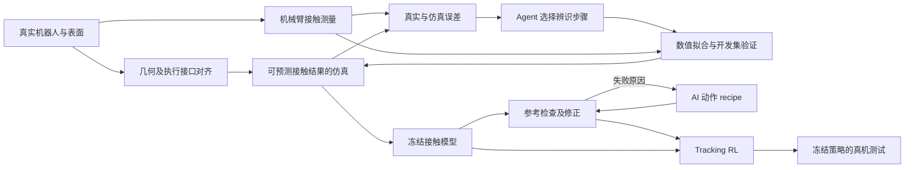

**当前收敛方案：机械臂 + microspine + agentic real2sim + motion tracking RL**

2026-09-08，洛杉矶时间。接续[论文故事与实验设计](icra_2027_story_experiments_2026-09-08.md)。这是选题补充，未实施新的建模、训练或硬件实验。

**最新执行方案：**[单 unit 模型资产方案](icra_2027_unit_asset_plan_2026-09-09.md)，以单 unit 辨识、冻结物理资产、后续常规 RL 复用为主线；该文件取代下文及整 pad 阶段的范围、次数与主比较。

此前 2026-09-09 补充的[整 pad 实验协议](icra_2027_pad_experiment_protocol_2026-09-09.md)细化了补测、比较和 demo；其矩阵、次数及 A/B/C/D 定义现已由最新单 unit 方案取代。

**本轮按用户最新方向，将机械臂与一种实际 microspine pad 作为主平台。** 核心问题收敛为：对于具有方向性、随机承载和离散接触阶段的末端，agent 能否利用真实交互误差构建足以支持技能学习的仿真，再通过参考合成与 tracking RL 实现可重复的真实操作？此前的人形 climbing 资产提供接触模型、参考与训练经验，本轮论文的核心证据落在机械臂上。

题目暂定为 *Learning Microspine Contact Skills via Agentic Real-to-Sim and Motion Reference Tracking*。这里 agentic real2sim 指 agent 根据观察结果选择诊断和辨识步骤；motion tracking RL 指在固定低层控制接口上，学习跟踪参考并修正实际接触造成的偏差。两者职责需要分别评价。

**新检索到的相关工作进一步限定了 claim。** [Agentic Real2Sim，2026](https://arxiv.org/abs/2607.19190) 已研究由视觉语言 agent 组织几何、物理参数与仿真工具来恢复可运行的交互场景；[VLM 行为树驱动的主动 Real2Sim，2026](https://arxiv.org/abs/2601.08454) 已研究按任务需要选择物理参数并通过真实交互辨识。因此，本项目不能仅把“agent 自动建仿真”或“agent 选择探针”作为一般性新贡献。需要检验的是实测 microspine 接触、模型误差诊断、参考可执行性和真实技能之间的具体联系。

**Agent 的最小有效职责，是完成一个可审计、依赖反馈的辨识循环。**

| 阶段 | Agent 所作决定 | 数值工具/已有模块负责的计算 | 必须记录的输出 |
| --- | --- | --- | --- |
| 看真实数据 | 当前问题主要表现为位姿响应误差、保持容量误差，还是阶段/力矩相关误差？ | 同输入回放、wrench 变换、事件提取、残差统计 | 数据版本、误差定位、候选解释 |
| 选择辨识 | 优先校准哪组有数据支持的参数，是否需要更换预先定义的模型配置？ | 现有分布拟合、参数搜索、固定模型集合比较 | 工具选择、拟合数据、估计与未解决问题 |
| 验证与再决定 | 开发集预测是否改善；继续校准、要求缺失测量，还是冻结模型？ | 独立于训练目标的预测指标、回放和约束检查 | 每轮指标、停止原因、模型版本 |
| 冻结后生成参考 | 哪些 recipe 需要调整路径、阶段或时长？ | IK、固定物理模型、短动力学回放 | proposal、失败原因、最终参考 |

首版允许 agent 在现有工具与少量已实现的模型配置中选择，拟合由确定性工具完成；它不需要自由编写接触力学内核。对于现有数据不能识别的预压依赖、疲劳或载荷重分配，正确结果可以是“需要补测”，而不是输出未经支持的参数。

一个应当能在真实数据上验证的诊断例子是：居中加载预测较好，带偏心的加载明显过于乐观。Agent 应检查 wrench 参考点、装配几何与力矩相关的模型假设，并调用对应分析，而不是直接把全部承载容量统一调低。这个例子是拟议评估问题，尚不是已完成演示；固定规则或数值模型选择也可能解决，需要公平比较。

最小版本先做基于已有真实日志的 agentic 诊断与工具编排。可选的下一步，是从预先验证的试验协议中选择补测。若只在预采集数据池里查询结果，应称为回顾性查询实验，不能据此声称已经实现自主物理探索或实际减少了采集次数；只有在线选择并执行新试验才能支撑后一类 claim。

辨识循环与参考循环分开：前者只能根据真实开发数据及预测误差修改 simulator；模型冻结后，后者只能修改 reference。最终测试数据不供 agent 调参。这样可以检验它是否学到了有效的物理模型，避免通过改变 simulator 让生成动作显得成功。

**机械臂的 tracking 采用任务空间参考更直接。** 拟议参考包含 pad 位姿、阶段、时长和加载要求；自由空间阶段主要跟踪路径，建立与加载阶段根据任务跟踪相应方向的力/负荷，并允许位姿作有限调整。位置和力的约束按阶段/方向安排，避免要求同一自由度同时满足相互冲突的硬目标。

优先让 policy 输出现有真机阻抗接口可执行的末端位姿残差；若实际部署只有另一种接口，应在实施前固定对应形式，并让仿真和全部基线一致。Actor 使用关节状态、末端状态、可用腕部力/力矩历史、参考与阶段信息；仿真挂接真值和 unit 容量仅可供 critic 或评估使用。阶段判定在部署时要由实际可用的传感器/估计器提供。BeyondMimic 可提供参考跟踪训练范式，现成人形配置不能直接视为机械臂控制器。

首个任务固定为同一条接触技能序列：接近区域 A、建立接触、承受规定载荷、卸载释放、移到 B、重新挂接并加载。目标位置、对齐误差、加载方向和偏心要求组成任务实例变化。若已有可用粗糙试件和夹具，可进一步验证提起/转向等实际操作；这项扩展以现成硬件为条件，不替代接触序列的定量比较。

**此前 E1–E4 之外，agentic claim 需要增加一组辨识流程比较。** 冻结同一初始模型、真实开发数据、可用工具、参数范围和验证标准，比较固定自动辨识流程、合理的数值优化/固定模型选择流程、agent 反馈循环；有条件可记录工程师完成同一工作的时间作为参考。测试其最终独立预测误差、工具/仿真调用数、总耗时、人工干预次数，而不只评价解释是否合理。工具端拟合计算和模型调用时间都计入预算。

至少在若干预先划分的真实开发/测试任务实例上重复，而不是只展示一次 agent 成功修复。模拟植入错误可以测试诊断软件，但不能替代真实误差的辨识证据。只要最终 simulator 一样好，固定流程就是强基线；若 agent 没有减少成本或提高预测质量，就将它定位为自动化接口，保留经验接触模型和参考学习的主贡献。

这一辨识比较先做离线实验，不必为每种 agent 配置重新训练 PPO。下游学习先采用本文件后面的 A/B/C 三组，并保留传统控制器和最强参考生成对照。只有当要声称 agent 相比固定辨识额外改善真机策略时，才需要将相应 simulator 分别接入同预算的训练与真实评估。

**实现起点仍需明确：现有 Rizon4 是测试基础，agent 与机械臂 tracking 任务尚未实现。** [Rizon4 环境配置](../src/scr_phybot_mjab/tasks/microspine_rizon4/config/rizon4/env_cfgs.py) 当前奖励为空，交互参数较宽松；[PadTeleop](../src/scr_phybot_mjab/tools/limit_surface_teleop/pad_teleop.py) 使用 MuJoCo 中的力矩注入进行仿真加载；[sweep 脚本](../scripts/sweep_rizon4_limitsurface.py) 是仿真扫描，不能当作实际机械臂 API。真实试验数据已经存在，但执行接口、实际 pad 模型、接触状态观测、reference 消费端与 policy 部署仍需逐一对齐。本轮研究讨论没有启动这些训练或硬件动作。

**建议将 real2sim2real 作为已有方案的总体组织方式。** Real-to-sim 对应真实几何、执行接口和 microspine 接触能力的识别；sim 中完成 reference 合成与 tracking RL；sim-to-real 对应冻结策略在真实短接触序列中的验证。接触失效采集因此直接服务于一个可检验的学习流程。流程名称本身不增加独立贡献。

新增的[Shengjie Wang 帖文](https://x.com/ShengjieWa34067/status/2097515070519734662) 描述 GPT-6 设置 MuJoCo、获取 DROID/Franka 资产，并根据单个视频重建场景，强调阴影、背景和人物的外观一致性；作者注明作品来自 Guanghe Li。初步核查通过 FxTwitter 公开镜像读取正文和视频元数据，随后已补查原视频关键帧，显示 real/sim 多相机对照。正文与关键帧均不足以确认它已经完成接触参数辨识、仿真训练及策略回到真机的完整实验。模型入口与视频证据详见[接口核查](icra_2027_agent_interfaces_2026-09-08.md)。

该演示可以启发 AI 辅助配置场景，但论文仍需区分三种可检验的能力：

| 能力 | 所需依据 | 对本项目的作用 |
| --- | --- | --- |
| 场景几何与位姿一致 | CAD/URDF、测量、相机标定或带尺度的深度信息 | 确保墙面、pad、目标区域和坐标系正确 |
| 对交互结果的预测一致 | 同控制输入下的位姿、wrench、滑移及接触建立/释放事件 | 决定仿真是否能检查 reference、提供有效学习信号 |
| 仿真中得到的能力能回到真机 | 冻结策略在未用于调参的真实 episode 上执行 | 支撑最终 real2sim2real claim |

普通单视频的外观重建不能唯一识别 microspine 的失效分布、各 unit 载荷共享或执行器响应。现有机械臂测量提供额外的物理约束；这正是本项目可复用且有辨识度的部分。

**推荐的完整叙事是：AI 能组织机器人资产并提出动作，真实交互数据使仿真具备任务所需的接触预测能力，从而将生成参考转化为可执行技能。**

Real-to-sim 的最小范围应复用现有 CAD、机器人模型与平面墙；根据实际测量对齐墙角、pad 安装和目标位置。AI 可辅助生成配置或解释坐标关系，人工测量的尺度和位姿仍明确记录。完整单视频场景重建可作为可选工具演示；若它不是方法重点，就无需重新训练视觉模型或开展通用场景重建评测。

物理辨识优先覆盖当前任务真正敏感的量：接触保持/脱离分布、pad 几何导致的力矩效应、建立/卸载过程；执行接口若存在明显偏差，再识别必要的延迟或等效柔顺参数。先用自由空间短动作检查执行器响应，再检查接触行为，可减少把控制器误差错误归因于接触容量的问题。有限数据无法同时唯一识别所有摩擦、刚度、阻尼和结构参数，应保留合理的不确定性与适用范围。

Sim 中仍采用之前的小型 recipe 合成：模型提出目标、阶段和局部路径，数值工具检查几何和实测接触需求，再训练固定的 tracking policy。首先固定接触模型、奖励和任务成功定义，让生成器只修改 reference。若需要更新模型，应使用单独的真实辨识数据；不能为让某个候选动作通过而随意放宽物理容量。

Sim-to-real 的最低证据是一端真实硬件完成规定的建立、加载、释放和重挂序列。机械臂真机的局部接触技能与人形仿真的多接触扩展要分别表述。使用过真实标定数据时，可以准确说明“标定后无策略真机微调”；不宜声称使用了零真实数据。若执行阶段又用真机失败调过参考、模型或策略，这些属于开发/适应数据，最终测试另行保留。

**这个组织方式需要补强“仿真能预测什么”的实验。** 原有 E1/E2 继续使用，但应增加同输入对照的呈现：从相同的初始状态，以对应的实际控制接口在仿真和真机执行同一段短命令序列；比较接触位置、pad 姿态、wrench、滑移及建立/释放事件。只在开始时对齐初始状态，后续让仿真动力学自由演化。逐帧写入真实位姿的可视化回放不能算动力学预测。

对于随机接触，不要求每次挂接在毫秒级复现同一随机失效，应比较多次独立挂接下的结果分布、保持比例、事件时刻分布及模型的错误接受。相同场景上多种预先冻结的参考，也可以比较 sim/real 的成功率与排序；少量参考的相关系数只能作辅助证据，不能替代试验次数和误差分析。判断模型有效应依赖未参与识别的完整试验，不能对 runtime 表的训练样本回放后宣称独立验证。

代码中已有可复用思路：[compare_real_sim.py](../scripts/compare_real_sim.py) 会把 C2 真机日志中的实际 PD 位置指令重放到 MuJoCo，比较关节轨迹与发散。当前脚本面向 walk_amp，尚不是完成的 microspine 接触序列验证器；可以复用日志对齐与同输入回放方式。旧 [tilt calibration 文档](microspine_tilt_calibration.md) 已注明部分设计被后续硬件替代，其中的仿真探针不能当作当前 pad 的真实参数辨识结果。

**若论文突出 real2sim2real，建议调整原 E4 主比较，明确区分接触模型与 reference 的作用。** 固定机器人、几何、执行接口和策略配方，使用下面三组作为最小学习比较：

| 组别 | 训练的接触模型 | Reference | 比较要回答的问题 |
| --- | --- | --- | --- |
| A | 合理标定的名义模型与常规 DR | 同一组几何修正参考 | 基线 |
| B | 实测条件失效模型 | 与 A 完全相同 | 加入经验接触辨识，是否改善 sim-to-real？ |
| C | 与 B 相同 | 用该模型检查和修正后的参考 | 固定经验仿真后，reference 修正是否进一步改善任务？ |

这里 A 不能只是明显不合适的文献默认参数；需要给它合理标定和调参。三组使用相同参考数量、任务目标、训练步数、传感信息和验证集选模规则；评估必须落在共同的独立测试系统及真机上，不能各自在自己的训练 simulator 中比较成功率。三组各 3 个 seed 为 9 个 run，可替换原三组主学习比较。原先的最强简化 reference 对照仍在 E3 中比较；如果它挑战核心新意，必须补进 E4，不能为了控制组数省掉关键对照。

另保留“完整参考 + 调好的传统控制器”来检验 RL 的作用，以及 E3 中的等预算数值搜索来检验 AI 的作用。若要研究经验模型用于生成与用于训练之间的交互效应，可补“经验参考 + 名义训练模型”构成 2×2；这属于进一步实验，不是最小 real2sim2real 故事的必要条件。

**当前贡献表述可组织为：真实接触误差驱动的 agentic 辨识与独立预测验证；该仿真指导的阶段化参考合成与 tracking 学习；冻结策略的真机技能与分层对照。** 失效曲线属于第一项的实验基础，其独立价值取决于对未见接触的预测和下游作用。第二项需要说明相比已有物理反馈参考合成的具体改进；第三项是系统实证，不另称一种新算法。单视频转场景、在仿真中反思失败都已存在相近研究：[SimFoundry](https://research.nvidia.com/labs/gear/simfoundry/) 将视频转为可交互场景并用于策略训练/评估；[EToT](https://arxiv.org/abs/2512.08188) 用物理数字孪生与 VLM 失败诊断进行 real2sim2real 操作规划。本项目的新意仍要落实在实测 microspine 接触、参考可执行性及真实控制的具体增量上。

按本次工期，优先使用一个现成台架和一种 pad 完成整条链；主动选择最有信息量的探针、跨表面快速更新模型、通用视频场景重建等方向留待核心证据成立后再扩展。若 agent 相比固定流程没有可测增益，应调整题目及贡献，使它与最终证据一致。

**补充：Agent 构建真机实时系统与仿真的边界。** 用户进一步询问 realtime + 仿真以及 Astra play robot 的能力范围。这里分别讨论“搭建系统”和“运行时闭环”；以下架构仍为建议，未运行机器人或新增训练。

| 目标 | 可采用的实现 | 证据与措辞边界 |
| --- | --- | --- |
| Agent 搭建真机接入与仿真 | 根据已有 SDK、CAD、传感器和接口文档编写适配、记录、回放、建模与实验程序 | 是可尝试的工程自动化任务；需报告提供的资产、已有功能与人工干预，不能默认零基础完成 |
| Agent 在线操作并辨识 | 调用持续运行的本地工具，读取实验结果，选择下一步动作或拟合 | 支持事件驱动或逐段执行，不预先承诺固定模型响应频率 |
| 仿真与真机并行运行 | 本地状态估计更新快照，仿真从快照进行候选动作预测，agent 在动作边界选用结果 | 状态同步与动力学预测分别验证；每帧覆盖成真机状态只能证明同步显示 |
| 严格实时反馈控制 | 本地控制程序、已部署 policy 与机器人原生伺服承担有时限的计算 | Agent 可以编写该程序，但每周期等待云端模型响应不具备已验证的实时保证 |

[OpenAI 的 Astra 使用文档](https://developers.openai.com/api/docs/guides/latest-model) 确认异步工具调用：应用执行工具时，模型可以继续处理其他工作；执行和管理工具仍由应用负责。同一文档明确 Astra Fast mode 没有延迟 SLA。因此，异步与流式输出不能推出固定控制截止时间。不能凭公开材料给这些机器人演示指定模型调用频率或最坏响应时间。

作为硬件接口的具体例子，[Flexiv RDK 控制模式](https://www.flexiv.com/software/rdk/manual/control_modes.html) 区分 1 kHz RT 命令流与 NRT 离散命令；后者由机器人内部生成并平滑轨迹。这说明“模型发出一次指令后机器人持续运动”可能来自本地控制运行，但并未据此确认所列 Astra 演示采用哪一种接口，也未确认本项目真机当前的 RDK 版本、授权和配置。

此前核查仅读取了四条原帖文字及媒体元数据；现已补查原视频关键帧，尚未获得原始控制日志或实现代码。作者报告的内容分别是：[刷尖与相机运动关系校准](https://x.com/dhvanil/status/2097350152713363812)、[操作洗衣机旋钮](https://x.com/ARXrobotics/status/2096328304794210604)、[开柜门时发现滑脱并重试](https://x.com/ax_pey/status/2097037847396295037)、[由视频搭建 MuJoCo 场景](https://x.com/ShengjieWa34067/status/2097515070519734662)。补查确认旋钮视频标有 16 倍速，柜门界面调用了具名技能；细节见[接口核查](icra_2027_agent_interfaces_2026-09-08.md)。这些证据尚不能确定高速接触控制能力、独立试验成功率、物理参数预测精度，或已经完成训练后真机迁移。

其中刷尖帖子所述低于 0.2 mm 是作者给出的相机测量 tip movement，不能改述为未经标定即可获得 0.2 mm 三维绝对定位精度。柜门帖子说明作者观察到滑脱后的重试，不说明系统在微滑移发生前进行了力反馈补偿。

推荐采用分时尺度架构：agent 组织辨识和参考生成；本地 sim worker 完成回放、拟合和候选预测；本地 policy/传统反馈控制器执行动作；机器人原生伺服闭合底层回路。原始高频传感数据进入本地估计与控制，agent 消费带时间戳的状态、事件和片段摘要。新参考只在规定动作边界切换；模型修改在辨识阶段验证并版本化，最终评估冻结模型、参考选择规则和策略。这里的冻结规则适用于当前最小论文；如果另做在线适应，需预先规定可更新内容、数据预算和新的独立评估。

运行时必须明确 agent 未完成计算时的本地行为，测量观察数据年龄、模型调用延迟、仿真耗时、命令到达时间与控制周期遗漏。完成全部候选预测的速度也要计入，不能只报告单步物理引擎速度。首版不承诺每次真机动作期间重新训练 PPO；辨识和训练在部署前完成，在线选择已有参考或技能。如声称动作期间在线建模，则需另外测量更新耗时和后续预测改善。

**Astra 能生成快速运行的控制代码，因此研究不能仅靠“LLM 慢而 RL 快”成立。** 合理基线应允许相同传感信息和调参预算下的本地反馈控制，而不是让基础 agent 每个控制周期都等待模型生成指令。建议以同一 agent 为基础，比较通用机器人工具、加入实测接触仿真与参考修正、再加入 tracking RL 三种系统；同时保留前述固定辨识流程与 agent 辨识流程的独立比较。总任务时间、真实试验数、模型与训练计算、人工干预和完整任务成功率一起报告。

本项目应检验的是：通用 agent 借助交互和本地工具能完成哪些接触技能，任务相关的物理模型在何种条件下改善其决策，以及 learned tracking 在已有反馈控制之上是否继续改善执行。Microspine 的隐藏接触状态和随机承载需要实验约束；模型更强或反馈更快，都不能直接替代这些物理证据。
