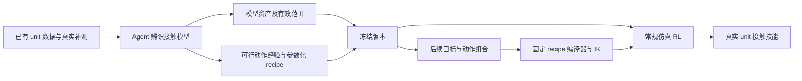

**当前最小方案：单 unit 辨识 → 冻结接触资产 → 常规 RL 学习后续技能**

2026-09-09。论文的必要硬件范围限定为单个 microspine unit；RL 用于检验物理模型作为可复用训练资产的价值。按最新要求，**当前先运行 P0：用现有模型训练一条 policy，验证挂接后的加载—保持—卸载**，详见[当前 pilot 方案](icra_2027_unit_policy_pilot_2026-09-09.md)。先完成该基线，再根据真实偏差启动下文的 agent 辨识和正式复用实验；E1–E4 的完整矩阵不是 P0 的启动门槛。

本文件取代[上一版整 pad 方案](icra_2027_integrated_experiment_plan_2026-09-09.md)的主线、组别和次数。残差诊断与 recipe 生成细节见[操作协议](icra_2027_unit_residual_recipe_protocol_2026-09-09.md)。全文为待实施设计，尚未新增硬件试验、实现新动力学或训练策略；已完成的工作仅包括日志和代码接口核对。

**研究问题与最低证据**

研究问题：能否把 agent 在真实交互中获得的物理认识和动作经验，整理成一个冻结、可执行的接触资产，使后续目标和动作组合只需常规仿真训练，而无需再次辨识接触模型或让 agent 介入训练循环？

单 unit 可以支撑这一范围。必要证据是：（1）对未参与辨识的 unit 接触轨迹具有预测能力；（2）冻结模型后，在至少两类后续动作上训练并执行真实策略；（3）相同参考和训练配方下，比较不同物理模型的作用。整 pad 的载荷分配、制造差异、跨表面泛化及人形攀爬留作后续验证，不作为本轮论文成立的前提。

候选贡献组织为：真实数据约束的接触模型诊断与修正；从一次辨识导出可重复调用的模型及参数化动作 recipe；同一资产在后续技能学习中的独立物理与真机验证。JSON 封装、使用 coding agent 或使用 PPO 本身不单列为新算法；方法价值取决于与常规辨识及通用 agent 的比较。

**术语与运行边界**

用户所指的“offline”按离开真机、离开 agent 循环训练理解。如果 PPO 等算法继续在冻结仿真中采样，论文称 **基于已辨识仿真的策略学习** 或 **辨识后无需额外真实训练数据的 sim-to-real**。严格 offline RL 使用固定数据集且不继续采集交互数据；本轮不为术语额外引入 IQL/CQL 等算法。[Offline RL 综述](https://arxiv.org/abs/2005.01643)。

Agent 反复提出假设、改模型和试动作，可以称 agentic system identification / search。除非真的更新 agent 的策略并以奖励训练，不把这个外循环称为训练 agent 的 RL。后续 tracker 可以沿用 [BeyondMimic 的参考跟踪思路](https://beyondmimic.github.io/)，但需适配机械臂的观测与实际执行接口。

**辨识和动作探索可以交替，但每条数据的含义必须固定**

Agent 可以边观察失败边发现较好的预压、拖动、加载和释放方式。这些动作经验进入 recipe，而物理修改必须解释真实记录的原始命令、载荷、位移与事件。新动作若实际执行，其结果作为新增开发数据记录；仅在仿真中成功不产生新的真实物理证据。

对每条真实试验保持输入序列不变，做同输入预测。允许从旧数据提出新实验，但不能同时改掉真实输入和模型，再把新动作成功算作旧模型误差被解释。Agent 可直接试改参数，也可调用数值拟合器；评分函数、原始日志和最终测试集固定。

这里区分两种辨识层级：单 unit 边界驱动试验可把实测相对位移作为输入，只评分预测力/事件；完整机器人回放则重放实际下发的控制命令，由仿真独立产生状态。作为输入强制给定的量不能再作为预测准确性的证据。实时并排运行是可选的执行方式，旧日志离线回放同样可以启动辨识。每条试验内模型固定，试验之间才更新。

动作成功率和物理预测误差分别评价。真实与仿真在相近条件下都失效，可以是正确的物理预测；模型已准确预测的失败动作需要修改 recipe。所有试验保留，按阶段提取候选有效片段和失败约束，不等待整条动作首次成功才开始整理参考。

正式冻结前，可将已验证动作整理为 `approach → preload → rake seating → load → unload → retreat` 的参数化程序，保存适用范围与失败条件。冻结后训练新任务时，只由确定性程序、IK 和普通数值检查生成参考，不再调用 LLM 反复修模型/动作。若继续由 agent 做任务级修正，就另记成本并缩小“后续无需 agent”的表述。

**E0：冻结现有基线，核对单 unit 接口与观测**

沿用现有测 unit 的台架和实际安装结构，记录 unit 编号、表面区域、磨损和安装状态。检查力/力矩参考点、符号、工具重力/必要惯性补偿与时钟同步；保存实际和指令量，并测 unit 相对墙面的位移。安装件可动时，TCP 位移不能单独代表 unit 滑移。

先独立检查执行器响应和测量滤波，确定实际可用的控制接口。没有足够观测分离安装件柔顺时，资产明确包含该安装条件下的综合有效响应，不宣称获得了可任意换安装方式的材料参数。

现有[经验表实现](../src/scr_phybot_mjab/microspine/empirical_limit_surface.py)注明其数据来自约 10 N 建立、法向力级约 3 s 的协议；这不识别预压依赖、疲劳、动态失效或全生命周期。原始 296 条 unit 试验继续用作先验/开发数据，优先从详细日志重提失效前稳定载荷；它们不再充当新模型的独立终评集。

旧 unit 曲线本身同样是待验证模型，不设为正确答案。允许依据一致的观测定义重拟合容量分布、加载成功概率及必要的条件关系；原始测量保持不变，事件提取与新旧标签转换记录版本。Agent 不能随意改测量或标签来支持自己的模型。

启动包由已有数据 D0、当前模型 M0、固定的回放/边界输入及评分定义组成。先建立初始残差报告，不要求先采满一套新试验。当前汇总 296 条中，275 条标签为 `detached_normal`；这是失效边界结果，不能把每条记录的所有阶段都判为动作失败。抽查的 3 条详细日志有时间、TCP 实测/指令、力/力矩及阶段字段，但无关节状态和完整控制器配置；现阶段可先做观测支持的 unit 级诊断。详见[只读日志清单](experiments/icra_2027_unit_asset_study/log_inventory_2026-09-09.json)。清单未判定成功片段，也未执行仿真或物理验证。

若需新采接口检查，只重复日志无法支持或安装已改变的短协议，例如 3–4 条协议各 3 次，作为起始排程而非精度保证。旧模型表使用了已有数据；这些数据的回放是开发诊断。若从旧数据重新划分保留集，必须用训练部分重建经验表等全部拟合组件，不能沿用全数据拟合表再称独立测试。

实现上需做真正的 single-unit 适配器。[pad 几何](../src/scr_phybot_mjab/microspine/pad_geometry.py)目前要求至少 2×2 unit 阵列；[阵列 wrench 分配](../src/scr_phybot_mjab/microspine/wrench.py)含空间二阶矩分母。因此不能只把 pad 的数量改成 1。单 unit 直接使用自身受力与接触状态，阵列层不进入本轮计算。

首版将接触姿态和力矩限制在实测覆盖的工况，记录实际力矩但不假设已得到任意六维承载模型。单 unit 具有有限尺寸；简化其力矩响应的适用范围必须标明。

**E1：现有数据先行，按残差缺口补测，另留独立终评**

先从旧日志选取覆盖不同阶段和载荷路径的代表性回放，形成固定回归检查集。运行 M0 获得初始预测误差，再让各辨识方法使用同一份 D0。以下四类是需要时选取的协议库，并非要求启动前全部新采：

| 类别 | 开发条件 | 主要观测 | 对应问题 |
| --- | --- | --- | --- |
| 建立 | 2 档预压 × 2 档 rake 拖动距离 | 随后相同检验载荷下的建立/保持、时间和位移 | 静态阈值是否足够，是否存在建立历史 |
| 亚失效加载—卸载 | 2 个主要方向 × 2 档速度 | 实际力—相对位移、恢复/残余位移 | 软约束参数或不可逆滑移机制 |
| 卸载释放 | 2 档卸载程度 × 2 种退出方式 | 残余力、脱钩距离、释放时刻 | 卸载/反向运动与释放条件 |
| 成熟承载复核 | 4 条代表性切向/侧向路径，阶梯改变法向载荷 | 最后稳定级、首次滑移、最终失效与删失 | 旧曲线在新采集批次的有效性，避免新增机制破坏原承载关系 |

补测由明确的替代解释触发：先查看已有数据或虚拟参数扰动能否区分，再增加改变一个关键因素的真实短协议。比如现有协议预压几乎固定，就不能只凭旧失效曲线辨识预压依赖；如要保留该机制，需不同预压下的可比较观测。建立、柔顺、历史或释放机制没有可辨识证据时，保持较简单模型或记录不确定性。

条件库见 [unit_condition_matrix.csv](experiments/icra_2027_unit_asset_study/unit_condition_matrix.csv)。其中 24 个候选条件、合计 96 条的重复建议保留为完整扩展排程，**不再是本轮启动条件或承诺采集量**。所有 `low/mid/high` 数值均待实际标定，不能直接执行。可选少量关键条件启动；是否扩大取决于误差和重复变异，而非凑满网格。

最终仍需独立 unit 预测测试。测试协议、采集块、样本数及评分在正式比较前固定，并与开发试验隔离；必要时使用预先保留的表面区域，但泛化表述保持在同 unit、同类表面、同安装条件内。上一版 48 条终评可作为覆盖四阶段的预算参考，不要求先采完才能开始 agent 实验。追加开发数据向所有比较方法共享并记录获取成本；最终测试不反馈给 agent。

记录实际/指令 wrench、unit 相对位姿、关节/TCP、阶段事件及原始视频。当前汇总的失效时实测力可能已下降，不直接作为峰值容量；阶梯失效是区间观测，到上限仍保持是右删失。建立阶段失败、未滑移和未释放都保留。连续帧/同一次挂接内循环不作为独立重复。

新增硬件记录按用途分别计数：接口/基线检查 N_base、针对性开发 N_probe、独立物理终评 N_test。主动补测数据向各方法共享的设计比较模型修正能力；若要另外声称主动选点优于其他采样策略，需要相同真实试验预算的独立比较，不从共享数据设计中推导该结论。

**E2：一次性辨识，比较什么**

| 方法 | 修改范围 | 目的 |
| --- | --- | --- |
| M0：当前经验曲线＋状态机 | 不用新增 unit 数据调整 | 原有模型基线 |
| N-fixed：固定结构数值拟合 | 少数既有参数 | 参数误差能解释多少 |
| N-library：数值模型选择 | 与 agent 相同的候选结构 | 强非 agent 基线 |
| G：通用 coding agent | 同样信息、结构与工具 | 通用试改流程的效果 |
| P：拟议接触诊断流程 | 残差分段、替代解释、区分检查、受约束修改 | 是否有额外的预测或搜索效率收益 |

候选结构先限定为现有模式、建立历史修正、或滑移/释放修正；首次至多加一个有数据支持的机制。每轮处理小参数块，不同时辨识全部刚度、挂接比例、unit 内部 spine 强度和疲劳。没有微观观测时，新增状态解释为有效建立/滑移状态。

G/P 可均直接提出参数；若加入数值拟合工具，两者均可访问，再比较流程。N-library 拿到同一候选库。每种搜索方法建议 3 次独立运行，共 12 次搜索；模型推理、回放与全部内层拟合统一计入预算。开发集按完整试验/采集块交叉验证，最终模型由开发规则选择，不用保留测试挑最好版本。

终评关注阶段成功/失败预测、力—位移响应、释放/失效事件时刻与保持概率。概率模型报告校准和预测区间宽度；模型比较使用相同随机挂接采样规则。候选不能通过延长免失效窗口、无限跟随 anchor、重采随机容量或扩大未知力域获得分数。完整动力学预测不得逐帧写入实测状态；边界驱动的 unit 测试须明确输入，且不评分该输入的“预测准确性”。

参数表现为随机时，辨识共享的条件分布及时间/跨载荷相关结构，不要求同一参数或某个 seed 复现所有真实记录。挂接间变异、过程状态变化、测量噪声和参数估计不确定性分别记录。采用概率评分并同时检查区间覆盖和宽度，不能用任意增大方差代替结构修正。Recipe 经多个随机样本筛选，RL 从冻结分布采样；详细协议见配套文件的 3a 部分。当前已有随机经验模型继续作为 M0，不能只拿确定性均值模型作唯一对照。

每个候选检查参数在实际仿真中生效、代码有限输出、接触方向/耗散约束和代表性时间步敏感性。新增机制删除后再评价一次，隔离结构贡献。模型的渲染相似、成功一次及参数被唯一识别是不同证据。

**E3：冻结并导出真正能复用的资产**

| 资产组成 | 必须保存什么 | 为什么需要 |
| --- | --- | --- |
| 可执行接触模型 | 状态、状态更新、力/约束响应、释放逻辑、复位规则及源码版本 | 新训练任务直接调用物理过程 |
| 参数与随机性 | 有效参数、分布、条件关系和每次挂接的随机量生命周期 | 训练覆盖已辨识不确定性，保持时间一致性 |
| 几何与坐标 | unit 接触参考点、rake/法向、几何、单位及安装变换 | 从台架接入机械臂仿真 |
| 适用范围 | unit/表面/安装、预压、力、姿态、速度与保持时长范围 | 限定可复用范围，标记未知工况 |
| 测量/执行接口配置 | 传感滤波、延迟、工具/安装响应是否被包含 | 避免把台架补偿误当普适接触参数 |
| Recipe 库 | 已发现的建立、加载、释放顺序及参数化参考编译器 | 后续按目标生成参考，无需 agent 再探索 |
| 复现与验证 | 数据划分、采集协议、构建入口、哈希、同输入预测报告 | 干净进程能够加载并重复验证 |

可填写的 [asset_contract.template.json](experiments/icra_2027_unit_asset_study/asset_contract.template.json) 是计划模板，不是已经辨识好的模型。最终资产只有在参数、实现、适用范围和验证记录齐备后才标记冻结。

资产验收做三件事：干净进程只用导出包重建；在需要的批量仿真接口正常 reset/step；使用完全相同的模型哈希训练后续任务。训练与执行没有 LLM 调用、没有接触重新拟合、没有新增真实训练数据；真实终评仍需实际执行并留档。

**E4：资产冻结后，两类后续技能，使用同样的 reference 与 RL 配方比较模型**

后续任务家族可以预先公开，但用于训练/终评的具体目标、载荷时间表和接触位置按预定规则在资产冻结后生成；它们不参与模型修正。变化必须位于资产的已辨识范围内。这里检验新目标与动作组合的复用，不声称跨材料、跨机器人或任意新物理机制泛化。

| 技能 | 过程 | 它对复用的检验 |
| --- | --- | --- |
| S1：挂接后的变载荷与主动释放 | 未挂接 → 建立 → 按新的载荷时间表承载/改变负荷 → 卸载释放 | 模型支持新的动态使用方式，reference 不只是重播旧日志 |
| S2：接触位置转换 | 未挂接 → A 建立承载 → 释放 → 到新的 B → 重新建立承载 → 结束 | 同一 unit 模型支持多次接触切换和新空间目标 |

载荷保持建议以约 3 s 为起点，数值按 unit 能力与实测时域确定。使用实际拉离/剪切承载要求，不能靠额外持续压墙替代抓附；预压、任务目标、总时限和自主重试预算在终评前固定。机械臂底座固定，演示称 unit 接触技能，不称自主攀爬。

最小主比较只有两组：

| 组别 | 接触模型 | Reference | 策略学习 |
| --- | --- | --- | --- |
| A | E2 开发验证选出的最强非 P 模型 | 共同冻结 recipe 生成的同一参考集合 | 常规 tracking RL |
| B | P 导出的冻结模型资产 | 与 A 完全相同 | 相同 RL 配方/观测/动作接口 |

两组都获得 agent 已发现的可行动作经验，避免把“有好动作”与“有好模型”混在一起。Reference 库和任务样本逐项相同，只改变接触模型；其余执行器、训练预算和非目标因素的随机化一致。M0 仍在 E2 里评价，不必单独再占一组正式 RL。

最小版每个模型训练一个覆盖 S1/S2 的 reference-conditioned tracker，各 3 个 seed，共 **6 次训练**。这是同一冻结资产支持多动作学习；不是声称 policy 零样本学习未知技能。若要专门演示新任务到来后单独重训，可另加独立训练任务，预算另计。

真机：2 种模型 × 2 类技能 × 每格 15 次尝试 = **60 次正式执行**；各 RL seed 每技能执行 5 次。初始偏差从各组共享的预定分布抽取，不再额外乘一套条件组数。报告任务成功、实际承载、滑移、意外脱离、释放失败、完成时间及每个 seed 结果。

Actor 使用真机可得的关节/末端状态、力/力矩历史、reference 和可实现阶段估计；隐藏挂接强度或仿真真实状态不进入 actor。单位级接触模型与机器人执行器模型分别固定。真机反馈只用于终评，不用于选 checkpoint 或再次修模型；若改动，需新终评数据。

本轮不把“RL 优于所有传统控制器”设为核心主张，因此传统控制器不占最小主训练矩阵；仍用合理反馈程序完成台架和部署检查。若希望声明 RL 相比直接执行 recipe 更优，再加同参考反馈控制器实测，不拿缺少反馈的开环作为唯一对手。

**复用成本怎么报告**

将一次性辨识、动作探索、资产导出和接口开发成本单列；对 S1/S2 分别记录参考编译、仿真训练、GPU 时间与真实终评成本。新增任务的接触重辨识次数、LLM 调用和真实训练试验应为零，需由实际运行记录支持。

整体成本按 `一次性辨识/导出 + 各任务参考/训练/终评成本` 展示，不能把 GPU 或真实终评算成免费。未实际运行“每个新任务重新 agent 搜索”的对照，就不声称相对该流程省了某个百分比；可以报告本流程实际没有重复辨识。

**预算、顺序与 demo**

| 项目 | 当前最小计划 | 备注 |
| --- | ---: | --- |
| 已有单 unit 数据 | 296 条复用 | 先验/开发；不进入新终评 |
| 接口与基线补测 | N_base，按缺失项决定 | 旧日志支持的项目直接复用；新采才计数 |
| 针对性接触补测 | N_probe，按辨识缺口决定 | 改变能区分替代解释的因素，各方法共享 |
| 独立物理终评 | N_test，正式比较前固定 | 旧版 48 条是预算参考，不是启动要求 |
| 离线模型搜索 | 默认 12 次 | 四种搜索方法各 3 次，M0 无需搜索 |
| 常规 RL | 6 次训练 | 两种模型各 3 seed，覆盖两类技能 |
| 真机技能 | 60 次尝试 | 两种模型、两类技能，各 15 次 |
| 新硬件记录总量 | **N_base + N_probe + N_test + 60** | 不把候选协议库 96 条自动计入；其他调试另列 |

按试验记录计数；S2 一条成功序列含两次挂接，重试和提前失败另外标注。同一真实试验可同时用于模型开发与 recipe 开发，记录双重用途但不重复计算次数。调试、先导、中止与失败全部留档，不补成功样本替换失败分母。重复数是排程建议，不能据此承诺统计显著或 99% 可靠。

执行顺序：冻结 D0/M0 与输入输出定义 → P0 基线 policy 训练及加载 pilot → 旧日志与 pilot 残差报告、提取 recipe 候选片段 → agent 与基线辨识、按缺口补测、分阶段完善 recipe → 完整接触周期的开发验证 → 模型和 recipe 冻结 → 独立预测终评、后续目标生成与普通 RL → 新技能真机终评。P0 可以在 agent 辨识之前使用固定的 M0 训练；E4 的正式模型复用比较使用各自冻结版本。P0 如反馈为开发数据，就不再充当修订后模型的独立终评。实时并排回放不是开始这些工作的前提。

主视频展示：一次 unit 辨识与误差修正；冻结资产版本；不再调用 agent 的训练流程；S1/S2 两种真实技能。模型图展示未见条件的预测与基线，策略图展示固定参考下不同模型的迁移结果。整 pad 与人形只列为后续扩展，不要求为本轮另加硬件演示。

若 P 与 N-library/G 没有差异，保留模型资产和复用证据并收窄 agent 新颖性；若模型只能解释单一旧轨迹，补足预测验证后再声称资产可复用。论文价值来自经过验证的物理知识能持续支持策略学习，而非资产文件数量或模块堆叠。
