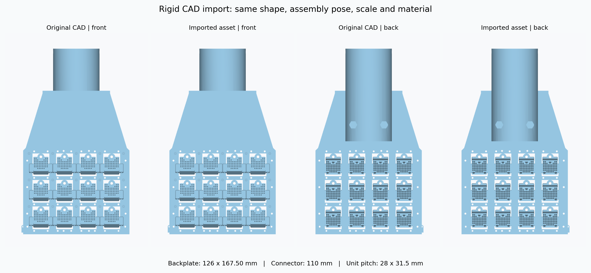

# PHYBot C2: rigid CAD pad assembly, 2026-09-06

The supplied CAD geometry and assembly poses are authoritative. The 34
exported solids retain their original shape, relative placement and colour.
The earlier manual 40/75/90 mm mounting dimensions are superseded. No
vertices are stretched, scaled or locally displaced, and no fabricated
pin or ball visual is added to the CAD assembly.



The columns show original/imported front views, then original/imported back
views, at identical orthographic scale. The earlier misleading arm detail
showed the back; the current `phybot_c2_cad_arm_detail.png` shows the contact
side. A separate `phybot_c2_cad_arm_back_detail.png` shows the rear.

## CAD mounting references

`tools/microspine/cad.py` reads the assembled URDF/GLTF geometry and analytic
cylinders in `cad_model/Assembly 1.step`. It identifies the sleeve stop and
the midpoint of the bearing seat without hard-coding STEP entity numbers.

In the connector's original local frame (metres):

- Sleeve mouth: `(0, 0, 0)`; internal stop E: `(0, 0, 0.035)`.
- Sleeve inner/outer diameters: 42 / 55 mm.
- Bearing seat: radius 7.5 mm, axial endpoints at y = 7.25 / 17.25 mm,
  both at z = 90.5 mm. The passive pivot B is its midpoint,
  `(0, 0.01225, 0.0905)`.
- Contact-array centre C is the mean of all 12 unit references. Relative
  to B it is approximately `(0, -0.04750002, 0.07798417)` m.

The whole assembly is rigidly mounted with E at the bare forearm's end and
the sleeve axis concentric with the forearm tube. The dummy hand/wrist shell
remains removed. The tube ends at elbow-local z approximately -188 mm;
B is now `(12.25, 0, -243.50)` mm and C is approximately
`(-35.25002, 0, -321.48420)` mm. Thus B extends 55.5 mm past the forearm end
and is 12.25 mm off its centre axis, as implied by the CAD seat.

Leg pivots retain their existing knee-local location `(68, 0, -159.35)` mm;
they use the same unmodified moving CAD pad. The supplied arm connector is
mounted on the arms only, since there is no leg connector CAD in this export.

| Dimension | CAD and imported asset |
| --- | --- |
| Backplate width × height | 126 × 167.50 mm |
| Connector axial length | 110 mm |
| Unit arrangement and centre pitch | 4 columns × 3 rows; 28 × 31.5 mm |
| Extreme unit-centre span, width × height | 84 × 63 mm |
| One unit envelope, width × height × depth | 27.90 × 25.07 × 15.00 mm |
| All units' envelope, width × height | 111.90 × 88.07 mm |

Unit references use the frontmost printed plane and the lateral/vertical
bounding-box centre, including the side wings. A measured spine-tip offset
is not present in the CAD. Individual source placements are preserved,
including nanometre-level URDF export rounding. Only the planar load model
projects normal scatter below 0.1 micrometre onto its plane; asset sites
and mesh vertices are not moved to enforce this numerical idealization.

## Contact and inertia

Only the four corner units have block collision proxies, using the actual
unit mesh bounds and CAD positions. Their holes and cutouts are not physical
collision geometry. All 12 unit sites participate in force/moment capacity.
The backplate's bounding collision box remains disabled by the shared
walk/climb collision configuration. Forearm tube, motor and connector
proxies remain enabled; connector envelopes are regenerated from CAD.

The weld anchor, runtime executor, IK and mount WBC use the explicit C site.
Older proxy-only benches fall back to their contact-face centroid. Moments
are evaluated about C; passive hinges pivot at B. The existing three-hinge
approximation, ±3-degree stops, stiffness and damping remain simulation
parameters: CAD geometry alone does not identify these mechanical properties.

Printed-solid volumes are assigned the existing provisional PLA density of
1240 kg/m³. There is no infill or measured-mass claim. Hardware absent from
the supplied CAD, such as the bearing and steel spines, is not fabricated or
silently assigned PLA mass.

| Component | Provisional mass | COM relative to B, mm |
| --- | ---: | --- |
| Moving backplate, units and brackets | 0.18690 kg | (0.0130, -36.4598, 46.6785) |
| Fixed arm connector, each | 0.20598 kg | (0.0007, -9.4941, -33.2142) |

The full robot's nominal mass is approximately 36.26111 kg. Full inertia
tensors, source hashes and CAD mounting references are in
`assets/phybot_c2/microspine_cad_geometry.json`, and inertias are written to
both MJCF and URDF. Forearm actuator/tube masses retain their existing
nominal values; their COM/inertia estimates exclude the removed hand shape.

## Verification and reproduction

[The compiled-asset audit](../reports/empirical_climb/rigid_cad_asset_audit.json)
compares every pad visual and both connectors against the source solids
in both nearest-vertex directions. Maximum deviation is about
0.0000112 mm, within float32 mesh storage precision. It also verifies the
CAD sleeve stops coincide with both bare forearm ends.

The active `climb_cad_empirical_initial.json` and `climb_cad_empirical.npy`
are regenerated for this geometry. Current geometry, contact, static-load
and runtime-reset results are in the
[empirical climbing review](../reports/empirical_climb/README.md).
Climbing retraining remains pending user acceptance. Legacy ground-to-wall
clips have not been retargeted. Geometric agreement is not a hardware
validation of the passive stops or full-pad load capacity.

```sh
export PYTHONPATH=src
export MUJOCO_GL=egl
export OPENBLAS_NUM_THREADS=1
/home/spider/miniconda3/envs/env_mjlab15/bin/python scripts/build_phybot_microspine_assets.py
/home/spider/miniconda3/envs/env_mjlab15/bin/python scripts/audit_phybot_cad_asset.py
/home/spider/miniconda3/envs/env_mjlab15/bin/python scripts/render_phybot_asset.py
/home/spider/miniconda3/envs/env_mjlab15/bin/python scripts/render_pad_collisions.py
/home/spider/miniconda3/envs/env_mjlab15/bin/python scripts/gen_cad_climb_reference.py
/home/spider/miniconda3/envs/env_mjlab15/bin/python scripts/audit_cad_climb_reference.py
/home/spider/miniconda3/envs/env_mjlab15/bin/python scripts/render_climb_initial.py
```
