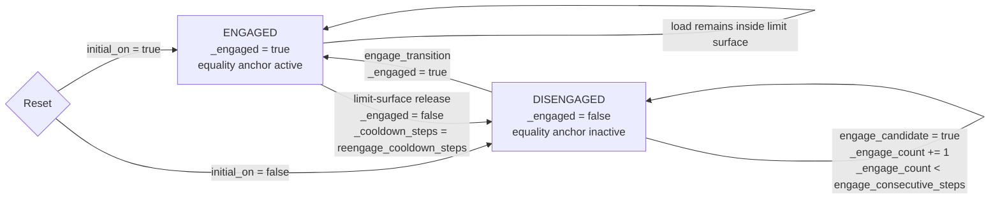

# Microspine State Machine

## Variables

| Variable | Shape | Meaning |
| --- | --- | --- |
| `_engaged` | `bool[num_envs, num_ee]` | The only persistent state. `true` means the EE microspine is enabled; `false` means it is disabled. |
| `_engage_count` | `int[num_envs, num_ee]` | Hysteresis counter for enabling microspine. It increments while an inactive EE satisfies `engage_condition` and cooldown is clear. |
| `_cooldown_steps` | `int[num_envs, num_ee]` | Re-engage lockout after disengagement. This is not a separate state; it only blocks the transition from `DISENGAGED` to `ENGAGED`. |
| `engage_condition` | `bool[num_envs, num_ee]` | All estimated unit preloads meet `engage_unit_preload_n`, plus seating, alignment and rake-direction gates. A zero unit threshold preserves legacy proxy-force or spring/shear gates. |
| `unit_preload_n` | `float[num_envs, num_ee, num_units]` | Estimated unit compression from the C-referenced contact wrench; empirical climbing requires every active unit ≥10 N. |
| `pad_contact_wrench_tln` | `float[num_envs, num_ee, 6]` | Substep-averaged contact force and moment about C, in rake/lateral/outward-normal axes. Separate from the latched anchor wrench. |
| `engage_candidate` | `bool[num_envs, num_ee]` | `engage_condition & ~_engaged & (_cooldown_steps == 0)`. |
| `engage_transition` | `bool[num_envs, num_ee]` | `true` when `_engage_count >= engage_consecutive_steps`; switches `_engaged` to `true`. |
| `forced_release_this_step` | `bool[num_envs, num_ee]` | Limit-surface violation after grace/debounce; switches `_engaged` to `false` and arms cooldown. |
| `command` | `float[num_envs, num_ee]` | Public command output from `MicrospineAffordance`: `_engaged.float()`. `MicrospineConstraint` uses it to toggle per-EE equality anchors. |

## State Machine

The preload gate only controls `DISENGAGED -> ENGAGED`. After engagement,
normal unloading does not release the pad by itself; the hold surface owns
release. Initial/RSI mature contacts bypass preload. Unit forces are estimated
with equal stiffness, rather than measured individually by the contact proxies.
Empirical climbing currently enables only CAD units (0,0), (0,3), (2,0),
and (2,3): `limit_surface.unit_layout="corners"`. The four units retain the
full pad lever arms, share both contact preload and latched wrench, and have
four persistent empirical capacity draws. The eight disabled units carry
neither load nor capacity. `"all"` retains the twelve-unit comparison.

Force, centroid torque, contact position and C position histories use the same
substeps. Each wrench is shifted to C before averaging over one policy step.
Empirical climbing uses three consecutive eligible policy steps; any failed
step or active cooldown clears the counter.

