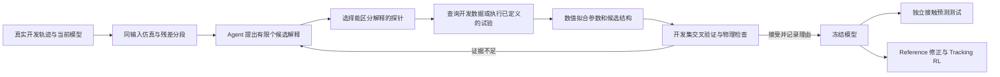

**Agent 根据真实交互修正不完整的 microspine 接触模型**

2026-09-09。接续[整 pad 实验协议](pad_experiment_protocol_2026-09-09.md)。本文件提出辨识方法与实验调整，尚未实现 agent、修改物理内核或运行新硬件试验。

**当前执行入口：**[单 unit 模型资产方案](unit_asset_plan_2026-09-09.md)。最新范围为单 unit 接触辨识和资产冻结后的常规 RL 复用；范围、次数及主比较以新方案为准。本文件保留模型辨识的技术讨论。

**可行目标是自动提出、拟合和检验接触模型修正。** 现有失效曲线约束给定建立/加载协议下的承载分布，尚不足以决定建立过程、承载时变形、可逆/不可逆滑移与卸载释放。Agent 可以组织这些问题的诊断；模型是否成立由真实留出试验判定。

用户提出的范围涉及参数辨识，也涉及模型结构辨识：前者改变已有阈值、时间常数或等效柔顺；后者增加当前模型无法表示的过程，例如建立历史相关的有效容量或持续滑移。最终仍是任务范围内的有效接触模型，不等于发现了每根 spine 的真实微观机制。

**当前实现的具体边界**

| 位置/机制 | 当前实现 | 对辨识的含义 |
| --- | --- | --- |
| `affordance.py` 的建立逻辑 | 预压/接触条件、几何对齐、rake 速度、连续满足次数和冷却时间 | 有若干可拟合的转移条件；其中 unit 预压来自载荷分配估计，并非逐 unit 传感 |
| `constraint.py` 的挂接执行 | 激活 connect 或 weld equality，保存挂接位置/姿态，按配置允许早期 reseat | 等效约束响应与真实 pad 柔顺之间需要辨识和验证 |
| `affordance.py` 的失效逻辑 | empirical 容量判断、读数等待、连续越界计数、整 pad 释放 | 承载边界与失效时序并非同一类参数 |
| empirical 模式的兼容性检查 | 拒绝 legacy spring field、seat capacity scaling、capacity ramp 和 F0 redraw | 现有单 unit 数据没有识别这些量；使用它们需要一个显式的新模型版本及数据支持 |
| `release_mode` | 仅实现 `binary`；`slip_drag` 为保留项，执行器会拒绝 | 要模拟真实持续滑移，可能需要实现新动力学，而非仅改变配置 |
| 随机性 | 每次挂接保留 unit 强度/早期加载随机量 | 比较重挂后的结果分布；不得靠每帧重采样容量去拟合失效时间 |

源码依据：[建立与保持判断](../../../src/scr_phybot_mjab/microspine/affordance.py)、[约束执行器](../../../src/scr_phybot_mjab/microspine/constraint.py)、[参数配置及历史说明](../../../src/scr_phybot_mjab/microspine/config.py)。配置中包含历史实验和不同任务分支的参数，不能假设它们全在当前 empirical 分支生效。

MuJoCo weld 本身是软 equality，`solref/solimp` 会影响约束响应。因此，小范围弹性位移首先检查现有约束能否描述；有不可逆滑移、路径依赖或逐步失效证据时再扩展结构。求解器参数不直接等于实物弹簧的 N/m、N·s/m；若拟合为有效参数，需固定执行器模型、时间步、solver 配置和任务范围。[MuJoCo weld 文档](https://mujoco.readthedocs.io/en/stable/XMLreference.html#equality-weld)、[solver 参数文档](https://mujoco.readthedocs.io/en/stable/modeling.html#solver-parameters)。

**先把可修改的东西分清楚**

| 类别 | 例子 | Agent 的处理方式 |
| --- | --- | --- |
| 测量/执行接口 | 力传感偏置、坐标参考点、工具重量、接口延迟、腕部柔顺 | 独立标定或作为有界 nuisance 参数；先排查，再辨识接触 |
| 接触参数 | 建立所需预压/拖动、有效弹性响应、容量缩放、反向脱钩条件 | 在真实开发轨迹上调用数值工具拟合，输出不确定性/等效范围 |
| 接触结构 | 容量依赖建立历史、可逆弹性之外的滑移、负载历史依赖的脱离 | 提出可检验假设，选择区分实验；证据支持后加入一个模块 |
| 数值与初始化设置 | force readout guard、solver 迭代、RSI 成熟挂接、初始化 reseat | 由数值验证约束，不能当作可任意调大的物理免失效时间 |

尤其不能通过延长不判断失效的时间、移动 anchor 跟随真实轨迹、放宽经验表定义域或增大冷却时间，使某条参考在仿真中成功，再称之为接触辨识。物理阈值和时间常数用 N、m、s 定义，数值防抖/等待与物理动力学分别记录。

**最小模型搜索范围**

首版保留既有 unit 数据与 pad 几何，只开放少量候选修正，按残差需要逐项增加：

| 候选 | 新增自由度 | 哪种观察值得启用 |
| --- | --- | --- |
| M0：现有模型 | 无 | 原始基线 |
| M1：相同结构重新标定 | 少数建立条件、承载缩放、可解释的有效柔顺参数 | 转移整体提前/滞后，或载荷—位移关系系统性偏差 |
| M2a：建立历史修正 | 一个有效建立程度 z，以及少量增长/转移参数 | 相同当前载荷与姿态，因之前预压/拖动/建立时间不同，保持概率显著不同 |
| M2b：滑移/释放修正 | 一个受力学约束的滑移状态或释放判据 | 卸载后仍有残余位移，或失效前发生可重复的持续滑移 |

M2a/M2b 是可选分支，不能默认全部叠加。将 z 称为“有效建立程度”，没有逐 unit 观测时不要解释成精确挂接 unit 数量。刚度、建立程度和 unit 容量相关性同时自由变化可能互相补偿，首轮优先拟合一个小参数块，并用敏感度/参数剖面检查是否能区分；不能识别的参数保留区间或固定。

一种候选结构是 `FREE → SEATING → ATTACHED → SLIPPING → FREE`，其中附着状态携带有效建立程度；但它只是待比较模型。若二态模型加合适柔顺已足够，就保留二态。额外状态的边界需由力和 pad 相对位姿支持；视频/传感器不能观测的隐状态不作为准确状态标签强行监督。

可允许 coding agent 在隔离的候选模块中生成缺失的更新函数，随后通过统一接口拟合和验证。主控制器、奖励、任务目标、原始数据及评分程序固定。候选函数必须满足单位一致、有限输出、合理接触几何、作用反作用和耗散等约束；近阈值短暂加载、卸载、循环加载及数值时间步变化需要检查。初版优先用显式候选模块，代码生成作为后续扩展，以控制工期和分析难度。

**Agent 的工作闭环**

工具可以包括 `inspect_trials`、`simulate_protocol`、`fit_candidate`、`compare_candidates`、`request_probe` 和 `freeze_model`。这些是拟议接口名称，并非现成工具。Agent 决定分析顺序、模型分支和下一条探针；数值工具负责拟合及评分；真实控制仍由本地已验证的试验程序执行。

每次决定留存：支持证据、至少一个替代解释、希望下一探针区分什么、参数边界、工具预算、结果和接受/拒绝理由。开发集内使用按完整试验/区域分组的交叉验证；测试集不向 agent 暴露。Agent 可在开发循环中拒绝更复杂候选，并报告缺少什么数据。

辨识目标同时覆盖：力/力矩轨迹、pad 相对位移、建立/释放事件及重复试验的保持分布。对不同量按噪声或量纲归一化，兼顾各阶段，避免大量低载荷帧淹没短暂失效；删失试验保留为删失观测。候选选择考虑验证质量、结构复杂度和运行成本。RL reward 和“这条动作能否成功”不作为辨识接触物理的唯一目标。

仿真只能从真实初始状态开始，执行相同外层目标和对应低层接口后自由演化。不能逐帧设置真实 pad 位姿，或强制施加真实接触力，再用轨迹一致作预测证据。传感滤波与延迟作为测量模型统一处理，避免人为移动事件时间获得更小误差。

**一个具体、可证伪的诊断例子**

观察：刚建立后立即拉载容易脱离，而采用另一段建立过程后成功；目前成熟容量曲线对后者较准。该观察现在是假设性的实验场景，不是已发现的结果。

| 候选解释 | 优先区分实验 | 支持该解释时才做的修改 |
| --- | --- | --- |
| 全局容量过高 | 固定建立过程，比较不同加载路径 | 一个全局容量缩放 |
| 有效建立程度依赖历史 | 相同预压、姿态和最终载荷，分别改变已完成的拖动量或等待过程 | 增加少量建立历史依赖参数 |
| 拉载的实际瞬态过大 | 对比实际力峰值，改变加载速率；先确认控制器响应 | 修正执行器/测量模型，或有证据的速率相关接触项 |
| 挂接响应过硬，无法表示真实滑移 | 低于失效区的加载—卸载，观测弹性恢复与残余位移 | 先拟合柔顺；仍有不可逆残差才增加滑移状态 |

例如“多等一会就更牢”并不能单独区分材料时间效应、额外拖动和控制器稳定过程。Probe 必须控制相关因素并记录实际运动。修改后的模型还应预测新的建立条件/加载速率，不能只复现触发诊断的那一次失败。

**对上一版实验设计的调整**

整 pad E1 留作成熟承载的预测锚点。上一版 E2 的 24 条建立—释放短序列是筛查起点，不能支撑同时辨识所有上述参数。根据筛查中最明显的两类残差，优先补两类辨识探针，避免全面铺开：

| 探针 | 控制变量/变化量 | 观测与对应辨识 |
| --- | --- | --- |
| 建立探针 | 预压、拖动量或建立时间中选少数因素；最终检验载荷相同 | 建立概率、达到检验载荷的保持率；建立阈值或有效建立程度 |
| 亚失效加载—卸载 | 最相关方向上的小幅循环，至少区分快慢加载 | 实际力—相对位移曲线、恢复/残余位移；有效柔顺与是否需要滑移 |
| 失效时序探针 | 相同建立，改变上升速率或保持时长 | 峰值、失效时刻和删失比例；是否存在静态曲线之外的时序依赖 |
| 释放探针 | 改变卸载程度与反向运动，固定退出目标 | 残余力、释放时刻/距离；释放与重新建立的条件 |

例如首轮每类可用 2×2 条件、每条件 3 次重挂作为探索性数据，再按结果增加重复；这个数量不是可靠性验证。保留新的条件组合和表面区域用于最终动态预测；先有最终测试预算，再扩大模型自由度。上一版总次数不包含这些新增探针，不能继续把全部辨识算在原 24 条内。

必须测 pad—墙面相对位姿；被动腕关节或安装件柔顺存在时，仅有 TCP 位移不能单独辨识 pad 接触刚度。没有足够观测时，输出的是腕部—安装件—pad 的综合有效响应，并相应缩小结论。

**哪些对照支持 agent 与结构修正的贡献**

1. M0 与固定结构数值拟合 M1：参数校准能解决多少误差。
2. 相同候选结构集合下的常规数值模型选择、通用 coding agent 与拟议诊断流程：相同数据、拟合器、候选模块、计算/探针预算，比较独立预测、数据需求和人工干预。不能让结构只有拟议 agent 能访问。
3. 固定结构与允许结构修正：检验“新增机制”是否改善未见条件预测；删除最终选择的模块作消融。
4. 冻结后的最强固定流程模型与拟议模型，按相同参考/训练配方比较真实技能：只有做了这一组，才声称 agent 的模型修正改善 sim-to-real。

若主动选试验是重点，还应有合理的信息量/不确定性选点基线。预采集池查询只支持回顾性查询效果；若要声称少采了真实试验，需要重复的在线选点与真实执行证据。Coding agent 的不同随机运行共享同一物理数据时，不能当作额外实物独立重复。

首版在每轮辨识只跑短仿真和拟合，模型冻结后再进行 RL；不为每个候选重训策略。冻结测试只作终评；看完测试再修模型，就需要新测试集。

**论文范围**

可将候选贡献表述为：“利用真实接触残差驱动模型诊断、区分性试验和受约束修正，使不完整的 microspine 仿真获得对建立、承载及释放的预测能力，并验证其对真实技能迁移的作用。”

已有 [Agentic Real2Sim](https://arxiv.org/html/2607.19190v3) 研究 agent 组织真实交互转仿真、物理先验与迭代修正。这里的具体增量需要由 microspine 不完整接触模型的修正方式和分层证据支撑，不能仅以“agent 会修改仿真代码”作为新颖性。如果常规拟合或通用 agent 同样有效，应按结果调整方法定位。
