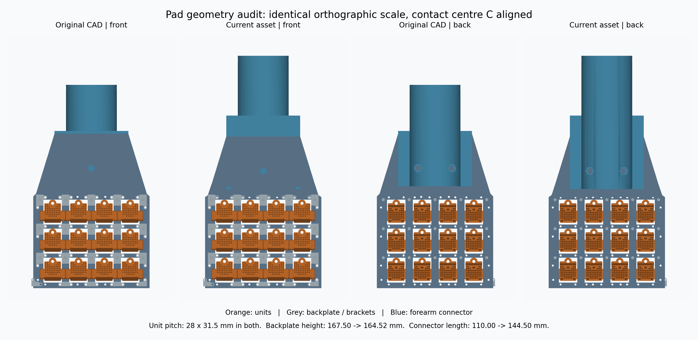

# 历史记录：刚性 CAD 修订前的尺寸复核（2026-09-06）

**以下描述的是修订前的 asset。** 用户随后要求完全采用 CAD 设置，现已撤销网格变形，
并按 CAD 安装基准重建。当前结果见 [rigid_cad_asset_audit.json](rigid_cad_asset_audit.json)
和 [asset 文档](../../microspine/phybot_c2_cad_asset.md)。下方对照图与数值保留为历史审计证据。

本次仅测量、渲染和记录；没有改动机器人 asset、motion reference、接触模型或训练配置。
尺寸来自原始 CAD 网格及当前 MJCF，并非按截图像素估算。

左起分别为原始 CAD 正面、当前 asset 正面、原始 CAD 背面、当前 asset 背面。
四图使用相同正交投影尺度，以接触阵列中心 C 对齐；橙色为 unit，灰色为背板及支架，
蓝色为连接件。展示的是导出的实体网格，没有叠加碰撞代理，也没有加入当前模型的简化球和销。

用户提供的 `cad_image.png` 展示正面，之前的 `phybot_c2_cad_arm_detail.png`
展示背面。背面的连接件遮住了梯形背板中央，unit 的背部外形与正面也不同。
这是两张原图外观差异的重要来源，但不能解释全部差异：当前连接件和背板确有网格变形。

| 尺寸项目（mm） | 原始 CAD | 当前 asset |
| --- | ---: | ---: |
| 阵列排布 | 横 4 × 纵 3 | 横 4 × 纵 3 |
| 横、纵中心间距 | 28 × 31.5 | 28 × 31.5 |
| 最外侧 unit 中心跨度（宽 × 高） | 84 × 63 | 84 × 63 |
| 单 unit 整体包络（宽 × 高 × 深） | 27.90 × 25.07 × 15.00 | 27.90 × 25.07 × 15.00 |
| 12 个 unit 整体包络（宽 × 高） | 111.90 × 88.07 | 111.90 × 88.07 |
| 背板包络（宽 × 高） | 126 × 167.50 | 126 × 164.52 |
| 连接件沿前臂方向的总长度 | 110.00 | 144.50 |

unit 包络包含侧翼，不是打孔小面的宽高，也不代表实际钢针尖端的接触面积。
背板主板厚约 6 mm，连接凸台计入后，背板网格的整体深度包络是 11 mm；
不能把这个 11 mm 误读成整张板的厚度。

所有 12 个原始 unit 与当前 unit 经各自中心平移后，最近顶点的最大偏差小于
0.000001 mm，没有发现 unit 被缩放或改变形状。
实际编译后的四个 pad 都是 12 个 unit，B 到 C 的 pad 局部位移为
`(0, -40, 75)` mm。每个 pad 的四角碰撞块仍为上述 unit 包络大小，
各块前表面均在 `y = -40` mm。共享力矩计算模块读取的中心跨度为
切向 63 mm、横向 84 mm，与横 4、纵 3 的站点位置一致。

当前 `scripts/build_phybot_microspine_assets.py` 的 `normalize_geometry()`
为满足先前指定的安装偏置，对连接件顶点施加了非刚性位移：沿长度方向增加 34.5 mm，
并按位置改变法向偏移，最大 12.25 mm。背板连接孔附近又移动了约 2.984 mm，
使背板总高从 167.50 mm 变为 164.52 mm。因此这套装配是按照指定安装尺寸调整过的
模型，不是原始 CAD 的刚性导入版本。

后续修订应保留 CAD 实体外形，把安装延长或偏置显式设计成连接结构，并同时核对
前臂端点、球心 B 和阵列中心 C。不能仅靠整体平移来同时消除上述尺寸差异，
也不能在替换网格后继续沿用未经复核的惯性估计。

完整数值、输入文件哈希和四个编译后 pad 的碰撞块记录见
[cad_dimension_audit.json](cad_dimension_audit.json)。
