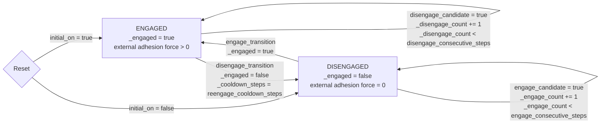

# Microspine State Machine

## Variables

| Variable | Shape | Meaning |
| --- | --- | --- |
| `_engaged` | `bool[num_envs, num_ee]` | The only persistent state. `true` means the EE microspine is enabled; `false` means it is disabled. |
| `_engage_count` | `int[num_envs, num_ee]` | Hysteresis counter for enabling microspine. It increments while an inactive EE satisfies `engage_condition` and cooldown is clear. |
| `_disengage_count` | `int[num_envs, num_ee]` | Hysteresis counter for disabling microspine. It increments while an active EE satisfies `disengage_candidate`. |
| `_cooldown_steps` | `int[num_envs, num_ee]` | Re-engage lockout after disengagement. This is not a separate state; it only blocks the transition from `DISENGAGED` to `ENGAGED`. |
| `force_z` | `float[num_envs, num_ee]` | Summed wall-on-EE force along world z. Positive values push the EE upward; negative values push it downward. |
| `engage_condition` | `bool[num_envs, num_ee]` | World affordance condition computed from contact sensor data and optional face-to-wall alignment. |
| `engage_candidate` | `bool[num_envs, num_ee]` | `engage_condition & ~_engaged & (_cooldown_steps == 0)`. |
| `engage_transition` | `bool[num_envs, num_ee]` | `true` when `_engage_count >= engage_consecutive_steps`; switches `_engaged` to `true`. |
| `disengage_candidate` | `bool[num_envs, num_ee]` | `true` when an engaged EE satisfies the configured negative world-z release-force condition. |
| `disengage_transition` | `bool[num_envs, num_ee]` | `true` when `_disengage_count >= disengage_consecutive_steps`; switches `_engaged` to `false` and arms `_cooldown_steps`. |
| `command` | `float[num_envs, num_ee]` | Public command output from `MicrospineAffordance`: `_engaged.float()`. `MicrospinePhysics` reads this and writes external adhesion forces on the sphere bodies. |

## State Machine

