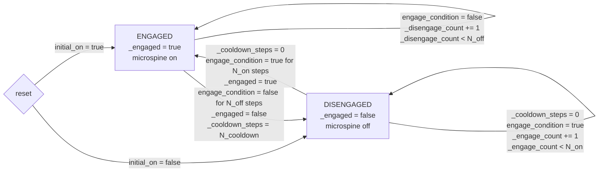
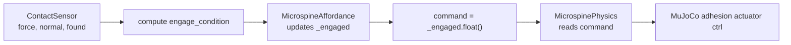

# Microspine State Machine Description

本文档只描述当前 C2 climb-wall 任务里的 microspine engage state machine。

## 1. 核心结论

真实状态只有一个变量：

```text
_engaged: bool[num_envs, num_ee]
```

含义：

| `_engaged` | 物理含义 | Physics 输出 |
| --- | --- | --- |
| `true` | 该 EE 的 microspine 已打开 | adhesion actuator ctrl > 0 |
| `false` | 该 EE 的 microspine 已关闭 | adhesion actuator ctrl = 0 |

下面这些不是状态，只是转移边上的辅助变量：

| Variable | 用途 |
| --- | --- |
| `_engage_count` | 防止单帧误接触导致 engage |
| `_disengage_count` | 防止单帧接触丢失导致 disengage |
| `_cooldown_steps` | disengage 后短时间内禁止重新 engage |

所以不要把 `_cooldown_steps` 看成第三个状态。它只是
`DISENGAGED` 状态下的一个 lockout guard。

## 2. State Machine 图



参数名：

```text
N_on       = engage_consecutive_steps
N_off      = disengage_consecutive_steps
N_cooldown = reengage_cooldown_steps
```

## 3. 更简化的 ASCII 图

```text
                         bad contact/orientation for N_off steps
      +-------------------------------------------------------------+
      |                                                             v
+-------------+                                           +----------------+
|  ENGAGED    |                                           |  DISENGAGED    |
| _engaged=T  |                                           | _engaged=F     |
| adhesion on |                                           | adhesion off   |
+-------------+                                           +----------------+
      ^                                                             |
      |                                                             |
      +-------------------------------------------------------------+
              cooldown == 0 and good contact/orientation for N_on steps
```

`DISENGAGED` 内部还有一个额外限制：

```text
if _cooldown_steps > 0:
  stay DISENGAGED
  do not count toward engage
```

## 4. engage_condition 是什么

`engage_condition` 是每个 EE 一个位：

```text
engage_condition: bool[num_envs, num_ee]
```

C2 当前由 contact sensor 和 EE 朝向计算：

```text
contact_condition =
  count(normal_force >= engage_normal_force_threshold) >= engage_min_spheres

orientation_condition =
  dot(ee_face_axis_world, wall_inward_normal) >= engage_parallel_cos_threshold

engage_condition =
  contact_condition and orientation_condition
```

C2 当前参数：

```text
spheres_per_ee = 4
engage_normal_force_threshold = 3.0
engage_min_spheres = 1
engage_parallel_cos_threshold = 0.25
engage_consecutive_steps = 5
disengage_consecutive_steps = 3
reengage_cooldown_steps = 15
initial_on = true
```

也就是说：

1. 任何一个 sphere 有足够 normal compression。
2. EE 的 microspine 面大致朝向 wall inward normal。
3. 上面条件连续成立 `5` step，才从 `DISENGAGED` 转到 `ENGAGED`。
4. 条件连续失败 `3` step，才从 `ENGAGED` 转到 `DISENGAGED`。
5. disengage 后 `15` step 内禁止重新 engage。

## 5. 源码对应伪代码

```text
engage_condition = compute_from_contact_sensor_and_orientation()

if _engaged:
  if engage_condition:
    _disengage_count = 0
  else:
    _disengage_count += 1

    if _disengage_count >= N_off:
      _engaged = false
      _disengage_count = 0
      _cooldown_steps = N_cooldown

else:
  if _cooldown_steps > 0:
    _cooldown_steps -= 1
    _engage_count = 0

  elif engage_condition:
    _engage_count += 1

    if _engage_count >= N_on:
      _engaged = true
      _engage_count = 0

  else:
    _engage_count = 0
```

## 6. 数据流



职责边界：

| Layer | 负责什么 |
| --- | --- |
| `MicrospineAffordance` | 根据世界接触和朝向更新 `_engaged` |
| `CommandManager` | 暴露 `_engaged.float()` |
| `MicrospinePhysics` | 根据 command 写 MuJoCo adhesion actuator |
| Policy | 不直接控制 microspine 开关 |
